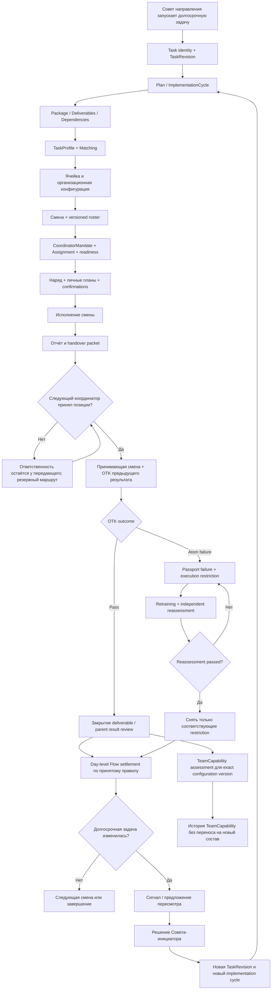

# XartIA — Фаза 10. Сквозная интеграция, переход и вывод старой модели

**Документный ID:** `X.0.01.41.10`  
**Название:** Сквозная интеграция, переход и вывод старой модели  
**Версия:** `0.2`  
**Дата:** 20 ноября 2026 года  
**Статус:** рабочая спецификация заключительной фазы; предназначена для применения после согласования и реализации Фаз 0–9  

**Межфазовая сверка:** 20 ноября 2026 года; `id_2.md` SHA-256 `f56080bd48936f7da21b526a7afc69c524f9787ab99d425231e6308220a093c7`; code snapshot SHA-256 `50e0f811141d3fa34c99d82a88e70998a4f03df72419c6b5ae7c3a674d770a70`; reference repo `main` `c03d8ce4fa5c1477adc46eb10fd297234bc03ffc`. Статический анализ; код/БД/тесты не запускались.
**Родительский архитектурный документ:** `X.0.01.41`, версия `0.6` (рабочая редакция, использованная при подготовке)  
**Предыдущие фазы:** `X.0.01.41.00`–`X.0.01.41.09`  
**Основной результат:** доказанная совместная работа принятых механизмов XartIA, безопасный переход существующих данных и контролируемое отключение только тех старых путей, которые действительно заменены.

---

## 0. Назначение документа и инструкция исполнителю

### 0.1. Что должна завершить Фаза 10

Фаза 10 не создаёт заново системы смен, координаторов, планов, задач, ОТК, Потока, Советов или командных оценок. Эти предметные механизмы принадлежат Фазам 1–9. Заключительная фаза проверяет, что они образуют один непротиворечивый рабочий цикл, что данные проходят через него без потери смысла и истории, а старые реализации не продолжают незаметно выдавать решения по отменённым правилам.

Итогом должны стать:

1. единая доказуемая сквозная цепочка от утверждённой долгосрочной задачи до принятого результата и, если задача пересмотрена, до нового цикла;
2. проверка совместимости контрактов задач, TaskRevision, планов, декомпозиции, ячеек, смен, ростеров, мандатов, назначений, личных планов, сигналов, передачи ответственности, ОТК, паспорта, Потока и TeamCapability;
3. проверка нескольких смен одной ячейки в одних календарных сутках, в том числе четырёх смен, без смешения их ростеров, назначений, результатов и ответственности;
4. проверка неполных ростеров и распределённого покрытия работы несколькими ячейками;
5. миграция существующих данных в целевую модель с явным различением подтверждённых фактов и неизвестной исторической информации;
6. контролируемое переключение интерфейсов, API, сервисов, фоновых задач и отчётности на утверждённые контракты;
7. отключение либо удаление старых путей только после доказательства, что они заменены, не используются и не являются единственным источником какой-либо ещё нужной функции;
8. синхронизация кода, миграций, тестов, ID-реестра и проектной документации;
9. итоговый отчёт с матрицей требований, тестовыми доказательствами, миграционным отчётом и перечнем оставшихся ограничений.

Фаза 10 не считается завершённой по факту прохождения одного happy-path теста, сборки приложения или появления новых таблиц. Нужно доказать целостность всего цикла, негативные сценарии, сохранение истории и безопасный переход со старых путей.

### 0.2. Порядок выполнения относительно Фаз 1–9

Настоящий документ подготавливается последним по нумерации, но **не разрешает преждевременно реализовывать Фазу 10 до завершения предыдущих фаз**.

Правильная последовательность проекта:

1. согласовать и уточнить спецификации Фаз 1–9;
2. реализовать соответствующие фазы в согласованной последовательности и принять их результаты;
3. обновить основной план, фактический ID-реестр и карту файлов;
4. выполнить preflight Фазы 10 на единой рабочей ветке;
5. только после прохождения входных gate выполнять интеграционные исправления, миграцию и cutover.

Если Фаза 10 обнаруживает отсутствие предметного механизма из Фазы 1–9, она не должна маскировать отсутствие локальным обходом или параллельной реализацией. Исполнитель фиксирует blocker, возвращает его в соответствующую фазу и указывает конкретный контракт, без которого интеграция невозможна.

### 0.3. Режим работы внешнего ИИ

Работа разделяется на две части.

**До утверждения модели:** `ANALYZE / DESIGN ONLY`.

В этом режиме исполнитель вправе читать код, миграции, тесты, строить граф зависимостей, проверять поведение и готовить проект интеграционных изменений. Запрещено менять исходники, миграции, данные, конфигурацию, реестр или документацию проекта.

**После утверждения интеграционного плана:** `IMPLEMENT / TEST / MIGRATE`.

Исполнитель получает явное разрешение на перечисленные изменения. Одобрение документа Фазы 10 само по себе не является разрешением на изменение GitHub-репозитория или рабочей базы данных.

### 0.4. Обязательные правила

- Не подменять результат предыдущей фазы собственной упрощённой реализацией.
- Не считать наличие записи в таблице доказательством завершённого бизнес-процесса.
- Не превращать отсутствие данных в положительное подтверждение, применимость или допуск.
- Не приписывать старым данным сведения, которых они не содержат.
- Не переписывать историю смен, ростеров, планов, подтверждений, назначений, решений, сигналов, ОТК, паспортных событий, Потока или командных оценок.
- Не удалять старые данные только ради упрощения новой схемы.
- Не удалять или отключать старый маршрут, пока не проверены все его вызывающие стороны и не подтверждена замена его обязанностей.
- Не менять нормативную семантику DEC в интеграционном рефакторинге.
- Не устанавливать отсутствующие кворумы, сроки, пороги, лимиты, коэффициенты и правила допуска.
- Не считать не запущенный тест пройденным; не считать статический просмотр кода запуском теста.
- Не переводить весь проект на Event Sourcing. Применять гибридную модель DEC-36.
- Не назначать номера новых ID и миграций по предположению. Сначала сверять актуальный реестр и фактическую ветку.

---

## 1. Цель и определение завершённого результата

### 1.1. Цель

Доказать, что принятые архитектурные решения XartIA работают совместно, а не только внутри изолированных модулей. В частности, система должна сохранять непрерывность долгосрочной задачи, но при этом различать институциональное владение, операционную ответственность, исполнение конкретной работы и подтверждение результата.

### 1.2. Что означает «сквозной цикл»

Минимальный целевой цикл состоит из следующих смысловых этапов:

1. компетентный орган направления принимает решение о запуске долгосрочной задачи;
2. задача получает устойчивую идентичность, владельца-Совет-инициатор и первую утверждённую редакцию требований;
3. задача получает план реализации и, если применимо, версионированную декомпозицию на `package` и исполняемые `deliverable`;
4. система определяет необходимые компетенции для работ и подбирает исполнителей/координаторов только по подтверждённым правилам допуска;
5. постоянные ячейки организуют выполнение через конкретные смены и версии временных ростеров;
6. координатор действует в пределах подтверждённой способности, недельного мандата и конкретного назначения;
7. общий наряд и личные планы создаются и подтверждаются субъектами, которым принадлежат соответствующие полномочия;
8. готовность смены проверяется до старта; фактическая работа и отчётность фиксируются в рамках конкретной смены;
9. результаты, открытые обязательства и сигналы передаются следующей смене; получение контекста не смешивается с принятием ответственности;
10. ОТК проверяет результат предыдущей смены по действовавшей версии требований и при соблюдении независимости;
11. последствия успешного/неуспешного ОТК отражаются в паспорте, ограничениях самостоятельного допуска, переподготовке, педагогическом контуре и дневном Потоке согласно DEC;
12. прогресс дочерних компонентов учитывается отдельно от окончательного ОТК родительской задачи;
13. TeamCapability, если он требуется для данного типа работы и утверждённой процедуры, относится к точной версии конфигурации команды и не заменяет индивидуальные допуски;
14. при изменении требований Совет запускает новый цикл, а предыдущий остаётся исторически воспроизводимым;
15. при положительном родительском ОТК задача закрывается по установленной процедуре, а не только из-за арифметики прогресса.

Не каждая задача обязана проходить все необязательные ветви. Например, командная оценка не должна автоматически требоваться для любой задачи, если соответствующий профиль её не предусматривает. Сквозной тест должен демонстрировать как обязательные, так и условные ветви.

### 1.3. Основное определение готовности

Фаза 10 готова, когда каждое принятое DEC-01–DEC-36:

- имеет однозначную связь с реализующим компонентом;
- имеет доказательство интеграции с соседними компонентами;
- покрыто автоматизированным тестом либо документированной процедурной проверкой с определённым ответственным, входными условиями, результатом и аудиторским свидетельством;
- не обходится старым endpoint, прямым SQL-путём, UI-веткой, worker или альтернативным service API;
- сохраняет исторические факты и корректно обрабатывает legacy-данные;
- отражено в актуальном реестре и документации.

---

## 2. Границы Фазы 10

### 2.1. Входит в область

1. Preflight всех результатов Фаз 0–9 на одном branch/commit.
2. Интеграция межфазных контрактов и исправление подтверждённых несовместимостей.
3. Сквозные сценарии: обычный рабочий цикл, несколько смен, неполный состав, передача ответственности, ОТК, провал атома, Поток, пересмотр задачи и новый цикл.
4. Проверка прав и границ доступа по всей цепочке.
5. Повторные запросы, конкурентные изменения, сбои API/worker и восстановление согласованного состояния.
6. Проверка миграций на чистой БД и на копии базы с legacy-данными.
7. Backfill только тех сведений, которые можно доказать существующими данными.
8. Временная совместимость API/UI и безопасное переключение на целевые контракты.
9. Поэтапное выключение старых путей, заменённых принятыми фазами.
10. Устранение оставшихся интеграционных дефектов, непосредственно мешающих принятым требованиям Фаз 1–9.
11. Обновление `id_2.md`, `check_files.md` или их актуальных утверждённых эквивалентов, основного плана и фазовых ссылок.
12. Сборка release-пакета и отчёта о фактической готовности.

### 2.2. Не входит в область

- Повторная реализация доменных функций Фаз 1–9.
- Новое изменение Хартии или полномочий Советов.
- Новая нормативная формула Потока, если она не определена в принятых DEC/решениях.
- Новые правила подбора компетенций, допуска, свежести, калибровки или XSK↔ATOM crosswalk.
- Новые нормативные сроки для смен, передачи, ОТК, хранения истории, повторного обучения или применимости TeamCapability.
- Новые пороги нагрузки, размеры команды, лимиты смен и ограничения координаторов, не принятые ранее.
- Автоматическая очистка всех технических долгов проекта, не относящихся к переходу Фаз 1–9.
- Массовое переписывание старых TASK-F01, истории или данных.
- Удаление старых записей, участников, задач, планов, сигналов, оценок или транзакций.
- Полный переход на Event Sourcing.
- Оптимизация производительности «на глаз» без воспроизводимых метрик и доказанной проблемы.
- Разработка новых бизнес-функций, не требуемых интеграцией.

### 2.3. Принцип минимального интеграционного изменения

Если несовместимость можно устранить точечно через адаптер/контракт без дублирования доменной логики, предпочтительно сохранить единственный источник истины. Если интеграционный дефект требует изменения предметной семантики, решение возвращается в соответствующую фазу и не маскируется в Фазе 10.

### 2.4. Как обращаться с необязательными контурами

Фаза 10 должна разделять:

- обязательные действия, без которых нельзя безопасно выполнить конкретную задачу;
- условные действия, включаемые профилем задачи или утверждённой процедурой;
- аналитические/информационные действия, которые не выдают допуск и не меняют статус.

Например, `TeamCapability` — отдельная командная оценка. Она не должна превращаться в универсальный обязательный gate для задач, если такого правила нет в TaskProfile или принятом DEC. Аналогично, наличие индивидуальных компетенций каждого участника само по себе не доказывает совместную TeamCapability.

---

## 3. Источники истины и порядок разрешения противоречий

### 3.1. Приоритет

При противоречиях применять следующий порядок:

1. прямые решения владельца проекта и принятые DEC;
2. актуальная утверждённая редакция `X.0.01.41`;
3. принятые и фактически реализованные результаты Фаз 0–9;
4. актуальный код, миграции, API, тесты и конфигурация согласованной рабочей ветки;
5. актуальный реестр ID и инвентаризация файлов;
6. старые TASK-F01, сохранённые code snapshots, отчёты и прежние схемы — как исторический контекст.

### 3.2. Фактический baseline

На дату подготовки спецификации репозиторий `vamhana/xartia` имеет default branch `main`; проверенный commit для этой редакции: `c03d8ce4fa5c1477adc46eb10fd297234bc03ffc` (`fix: require expected results for deliverable tasks`). Это только публичный статический ориентир, а не утверждение, что данный commit является будущей рабочей веткой реализации или production-базой.

Сторонний ИИ обязан заново зафиксировать branch и HEAD. Нельзя использовать строки, размеры файлов, перечень миграций или результаты тестов из старых snapshots как характеристики более поздней ветки.

### 3.3. Принятые фазовые результаты

Наличие спецификации Фазы 1–9 не доказывает, что её требования реализованы. Для допуска к Фазе 10 нужны фактические результаты реализации и приёмки: PR/commit, миграции, тестовые логи, актуальный ID-реестр и перечень открытых ограничений.

Каждая фаза получает один из статусов:

- `accepted` — реализация проверена, критерии выполнены и результат принят;
- `accepted_with_limits` — результат принят с явно ограниченной областью, которая не мешает конкретным сквозным сценариям;
- `partial` — реализована часть требований; интеграция зависит от непокрытого остатка;
- `blocked` — есть блокирующее отсутствие решения/контракта/реализации;
- `not_started` — реализация не подтверждена;
- `superseded` — требования перенесены/заменены новой утверждённой редакцией.

Только `accepted` либо `accepted_with_limits` с явно описанной допустимостью могут быть входом интеграционного gate. Если критический для сценария участок имеет статус `partial`, `blocked` или `not_started`, этот сценарий не может быть помечен `passed`.

---

## 4. Входные gate: что должно быть принято до начала Фазы 10

### 4.1. Сводная матрица Фаз 0–9

| Фаза | Обязательный входной результат | Что Фаза 10 должна подтвердить | Блокирующий признак |
|---|---|---|---|
| 0 — целевая модель и GAP | Принятые DEC, приоритет источников и базовая файловая карта | В коде не осталось неучтённых конфликтов с принятыми DEC | Требования неоднозначны или разные документы задают разные правила |
| 1 — XSK/атомы/калибровка/паспортный допуск | Версионированные компетенции, утверждённость атомов/критериев, applicability, Matching и freshness | Координатор и исполнитель не допускаются по draft/unknown данным; версия компетенции прослеживается | Unknown/candidate трактуется как подтверждение; обход gate через иной API |
| 2 — смены/временные ростеры | WorkShift, уникальная идентичность смены и версия её ростера | До четырёх смен одной ячейки за сутки различимы; история и назначения не смешиваются | Состав берётся из постоянного членства как исторический roster; смена не имеет стабильного ID |
| 3 — мандат/назначение координатора | CoordinatorCapabilityProfile, недельный CoordinatorMandate и CoordinatorAssignment | Проверяются пригодность, scope, срок, конкретное назначение и конкурирующие нагрузки | Роль в ячейке используется вместо актуального мандата/назначения или атомной пригодности |
| 4 — наряд/личный план/подтверждения | Версии общего наряда, личный план, авторство и подтверждение участника | Изменение затрагивает только нужные подтверждения; личный план координатора остаётся один | Публикация/наличие плана выдаётся за подтверждение; координатор подтверждает план за участника |
| 5 — готовность/жизненный цикл/отчёт | Shift readiness, явные переходы состояния и отчётность | Допустимый неполный ростер оценивается по фактическому покрытию; старт/отмена/закрытие проверяются | `ready` выводится только из числа участников или из статуса ячейки |
| 6 — handover/сигналы/ответственность | Пакет/позиции передачи, получение, принятие, отказ и резервная эскалация | Ответственность меняется только по явному акту принятия; трасса сигнала сохраняется | Получение пакета автоматически передаёт ответственность; старый ответственный исчезает |
| 7 — ОТК/паспорт/Поток | Независимый ОТК, failure event/restriction, переподготовка и day-level Поток | Провал атома влияет на самостоятельный допуск и Поток за день; педагогическая оценка отделена | ОТК проверяется без нужных атомов/независимости; Поток начисляется по каждому принятому deliverable без дневного урегулирования |
| 8 — долгосрочная задача/Совет/декомпозиция | TaskRevision, Council-initiator ownership, parent progress/OTK, cross-direction workflow | Пересмотр создаёт новый цикл, не переписывая историю старого | Плановая правка подменяет пересмотр задачи; владельцем становится координатор/исполнитель |
| 9 — TeamCapability | Неизменяемые версии командной конфигурации и assessment, привязанный к точной версии | Старая оценка не отображается как оценка новой конфигурации | Состав/критерии меняются в той же версии; оценка не знает, что именно оценено |

### 4.2. Требования к evidence каждого входного gate

Для каждой строки таблицы §4.1 должны быть переданы:

- документ/решение, определяющее целевое поведение;
- точный commit или PR, в котором реализован механизм;
- затронутые исходники и миграции;
- список тестов, подтверждающих критерии;
- фактический лог успешного запуска тестов на той же ветке;
- перечень ограничений и открытых решений;
- актуальный ID-реестр и инвентаризация изменённых файлов.

Скриншот интерфейса или запись в БД без воспроизводимого сценария не является достаточным доказательством сложного workflow.

### 4.3. Входной gate для реализации Фазы 10

До изменения кода сторонний ИИ возвращает матрицу §4.1. Если все необходимые для интеграционного цикла предметные механизмы не приняты, исполнитель представляет план устранения блокеров и останавливается. Не допускается «временно» реализовать новый WorkShift, CoordinatorMandate, OTK или task revision только потому, что их ещё нет в согласованной ветке.

## 5. Целевая сквозная модель работы

### 5.1. Старт долгосрочной задачи

1. Совет направления принимает решение о запуске долгосрочной задачи.
2. Запись долгосрочной задачи сохраняет устойчивую связь с Советом-инициатором как институциональным владельцем.
3. Конкретный советник/создатель записи не подменяет владельца задачи.
4. Фиксируются текущая версия задачи, ожидаемый результат и применимые критерии.
5. План реализации адресуется этой версии требований и не подменяет её.
6. Решение запуска, авторитетный источник, дата действия и актор доступны в истории.

**Проверка:** ротация состава Совета, координатора и исполнителей не меняет Council-initiator ownership.

### 5.2. Декомпозиция и планирование

1. Долгосрочная задача может иметь `package` как организационный контейнер и `deliverable` как исполняемые результаты.
2. Иерархия parent-child не смешивается с dependency graph.
3. Зависимости не создают автоматически межнаправленческих обязательств.
4. План может изменяться в рамках действующей версии задачи без подмены исходных требований.
5. Изменение цели, ожидаемого результата, обязательных требований или существенных критериев проходит маршрут TaskRevision Совета.
6. Прогресс дочерних компонентов отображается отдельно от окончательного закрытия родителя.
7. 9 завершённых из 10 — это 90%, а не `completed`.
8. Положительный родительский ОТК — отдельное условие завершения родительской задачи.

### 5.3. Постоянная ячейка и сменная конфигурация

1. Ячейка является долговременной организационной единицей.
2. Фактический состав для выполнения работы фиксируется через отдельную смену и версию её ростера.
3. Постоянное членство не является доказательством состава конкретной смены.
4. Одна ячейка может иметь до четырёх смен в сутки; четыре смены не должны иметь один общий roster snapshot.
5. Незаполненные позиции остаются видимыми в снимке и не превращаются в фиктивных участников.
6. Неполный состав сам по себе не означает автоматический запрет на существование смены; возможность выполнить конкретный объём определяется readiness по применимым требованиям.
7. Если несколько ячеек совместно закрывают работу, зона и вклад каждой должны быть различимы.

### 5.4. Координатор, мандат и назначение

1. Профессиональная пригодность координатора строится по реальным атомам задач, координационной деятельности и ОТК.
2. Недельный мандат — ограниченная ответственность, а не привилегия и не замена квалификации.
3. CoordinatorAssignment задаёт конкретную зону/смену/период в пределах мандата.
4. Возможность одного координатора покрывать несколько ячеек проверяется по подтверждённым компетенциям, scope и нагрузке; пороги не изобретаются.
5. Координатор отвечает за операционную непрерывность в своей зоне и свой личный план; не становится владельцем долгосрочной задачи.
6. Координаторская позиция не должна автоматически считаться одной из пяти рабочих позиций ростера, если целевая модель фазой 2 это разделяет.

### 5.5. Наряд и личные планы

1. Общий наряд ячейки/смены подтверждается уполномоченным принимающим координатором.
2. Личный план может быть подготовлен координатором, но его владелец лично подтверждает план до исполнения.
3. Личный план сохраняет дневную агрегирующую природу и конкретную связь производственных блоков со сменой/назначением.
4. Изменение версии плана/наряда должно лишать силы только затронутые подтверждения, а не незатронутые.
5. Изменение требований задачи направляет затронутые будущие/действующие циклы на повторное подтверждение согласно Фазам 4 и 8.
6. Координационные инструменты не создают второй личный план координатора и не приводят к двойному учёту времени.

### 5.6. Готовность, исполнение и отчётность смены

1. Readiness рассчитывается по конкретным задаче, ростеру, назначениям, подтверждениям и ограничениям.
2. Readiness ячейки и readiness смены — разные понятия.
3. Изменение состава после проверки readiness требует повторного пересчёта и, если это предусмотрено контрактом, нового подтверждения версии.
4. Начало смены, приостановка, возобновление, отмена и закрытие фиксируются явными переходами.
5. Отчёт смены содержит фактическое покрытие, результаты, проблемы, сигналы и открытые обязательства.
6. Отчёты нижних уровней агрегируются без потери ссылок на исходные смены и события.
7. Частичный сбой не должен приводить к статусу «завершено» без подтверждённых обязательных шагов.

### 5.7. Handover и сигналы

1. Пакет передачи контекста и акт принятия ответственности — разные объекты/факты.
2. Получение пакета не доказывает принятие всех позиций.
3. Для каждой позиции, требующей нового ответственного, сохраняется явный акт принятия, отказа или незавершённости.
4. До принятия ответственность не исчезает у передающей стороны.
5. Резервная эскалация использует тот же идентификатор и трассу исходного сигнала, а не создаёт несвязанные дубликаты.
6. Direction routing и responsibility transfer не смешиваются.
7. Сигнал закрывается инициатором после разрешения проблемы и исполнения/подтверждения решения по применимой процедуре.
8. Решение Совета по задаче не является автоматически закрытием сигнала; закрытие сигнала не означает TaskRevision approval.

### 5.8. ОТК, паспорт и Поток

1. ОТК предыдущей смены относится к результату и версии требований, действовавшим для проверяемой работы.
2. Проверяющий должен иметь необходимые подтверждённые предметные и проверочные атомы.
3. Проверяющий не принимает собственную работу и не выполняет запрещённую проверку работы бывшего ученика по соответствующему атому.
4. Решение ОТК и его доказательства сохраняются отдельно от статуса отчёта/передачи.
5. Провал атома создаёт запись о провале и ограничение самостоятельного допуска до переподготовки и успешной повторной проверки по правилам Фазы 7.
6. Завершение учебной практики не снимает ограничение само по себе.
7. Предметная компетенция учителя не понижается автоматически из-за педагогической ошибки; педагогическая оценка рассматривается отдельно.
8. Никакой положительный Поток за день провала атома не выпускается для этого day key.
9. Дневной Поток должен учитывать все требуемые результаты/смены за день, а не только отдельное событие принятия одной задачи.
10. Повторная доставка/обработка события не создаёт повторного начисления.

### 5.9. TeamCapability

1. TeamCapability оценивает точную конфигурацию людей, ролей и условий для конкретной работы.
2. Конфигурация ссылается на конкретный сменный ростер либо согласованный рабочий период с точными source identifiers.
3. Assessment ссылается на конкретную версию конфигурации, критериев и задачи/ожидаемого результата.
4. Изменение состава, ролей, условий, критериев или существенного результата не переносит прежнюю оценку автоматически.
5. Старая оценка остаётся исторически связанной со старой конфигурацией; legacy assessment с неизвестным составом не получает ложный snapshot.
6. TeamCapability не является суммой индивидуальных паспортов и не даёт автоматически персональные допуски/мандаты.
7. Team matching и оценка уже продемонстрированной командной способности — разные механизмы.

### 5.10. Пересмотр и новый цикл

1. Изменение задачи и изменение плана остаются разными процессами.
2. Сигнал об изменении внешних обстоятельств привязывается к конкретной версии задачи.
3. Совет-инициатор принимает решение в рамках своих полномочий; межнаправленческие изменения проходят предусмотренное согласование.
4. Новая редакция требований получает новую версию и запускает затронутую перестройку плана, декомпозиции, Matching, ячеек, смен, roster snapshots, подтверждений и TeamCapability.
5. Уже выполненные работы и решения ОТК оцениваются по старой применимой версии критериев; нельзя задним числом применять новые требования.
6. Открытые работы закрываются/переносятся по принятому сценарию без автоматического стирания старого цикла.
7. Исторический Council-initiator остаётся связанным с задачей независимо от ротации Совета.

---

## 6. Сквозные архитектурные инварианты

Следующие инварианты проверяются во всех слоях: core service, API, UI, SQL/миграция, worker и тестовые фикстуры.

| № | Инвариант | Запрещённый обход |
|---:|---|---|
| 1 | У одной долгосрочной задачи есть устойчивый идентификатор и исторический Council-initiator | Переназначение владельца на текущего координатора/исполнителя |
| 2 | TaskRevision и PlanVersion различны | Изменение требований через обычный patch плана |
| 3 | Иерархия задач и dependency graph различны | Использование parent-child как зависимости или наоборот |
| 4 | `package` — контейнер, а не обычный исполняемый deliverable | Назначение/сдача package как исполнительской задачи без принятого контракта |
| 5 | Дочерний прогресс не закрывает родителя автоматически | `done` при 100% детей без parent OTK |
| 6 | Ячейка долговременна, смена временна | Текущий `cell_members` как исторический roster конкретной смены |
| 7 | Каждая смена имеет собственную идентичность и временные границы | Схлопывание нескольких смен в одну дневную запись |
| 8 | Версия ростера immutable/восстановима | Перезапись старого состава без события/версии |
| 9 | Пустые позиции неполного ростера видимы | Удаление свободных позиций или фиктивное заполнение |
| 10 | Мандат и назначение координатора — разные сущности | Роль в ячейке как единственное основание полномочия |
| 11 | Компетентность и полномочие проверяются независимо | Мандат как доказательство предметной компетенции |
| 12 | Общий наряд и личный план имеют отдельные подтверждения | Публикация плана как подтверждение участника |
| 13 | Один координатор имеет один личный план | Второй план для панели сопровождения смены |
| 14 | Readiness смены зависит от реальной конфигурации и задания | Статус `ready` только из количества людей |
| 15 | Передача контекста не равна передаче ответственности | Автоматическая смена responsible при просмотре пакета |
| 16 | Сигнал, его маршрутизация и решение — разные процессы | Закрытие сигнала от одного ответа/смены уровня |
| 17 | ОТК требует квалификации и независимости | Самопроверка или проверка без обязательных атомов |
| 18 | Провал атома блокирует самостоятельный допуск к этому атому | Общее отключение/понижение всех компетенций без решения |
| 19 | Учительская способность отделена от предметной | Автоматическое снижение предметного уровня учителя |
| 20 | Поток рассчитывается на дневном уровне по утверждённому контракту | Повторное или частичное начисление за один принятый deliverable |
| 21 | Новая редакция задачи не меняет историю старого цикла | Переписывание критериев прошлого ОТК |
| 22 | Межнаправленческая зависимость не означает согласия другого направления | Автоматическое создание обязательства из технического FK |
| 23 | Дефицит компетенций порождает сигнал/решение по принятому маршруту | Снижение TaskProfile или обход Matching |
| 24 | TeamCapability привязан к версии конфигурации и работе | Перенос оценки на изменившийся состав |
| 25 | Командная оценка не заменяет индивидуальные паспорта | Выдача персонального Permit/допуска из team level |
| 26 | Исторические события и версии сохраняются | Очистка истории ради миграции или cutover |
| 27 | Повторный запрос не создаёт дубликат значимого события | Двойной ОТК/начисление/версия при retry |
| 28 | Каждый отказ имеет объяснимую причину и audit trail | HTTP 200/статус успеха при неприменённой операции |

---

## 7. Интеграционные контракты между доменами

### 7.1. Task / TaskRevision / Plan / Implementation Cycle

Проверить, что:

- все исполняемые `deliverable` относятся к конкретной задаче/редакции и имеют определённый ожидаемый результат;
- `package` остаётся контейнером, не получая автоматически назначение;
- parent relation и dependencies имеют разные FK/DTO/события;
- план может существовать в нескольких циклах без переписывания требований старой редакции;
- task progress не смешивается с parent acceptance;
- сигнал и решение Совета адресуют точный объект и версию;
- API не допускает прямого изменения требований в обход TaskRevision workflow;
- межнаправленческая связь содержит тип/основание и владельца решения по утверждённой модели;
- open questions Phase 8 не замещаются локальным правилом Phase 10.

**Особая проверка:** исторический код `createTaskService` проверял совпадение `plan_id` и `direction_id` для parent/child. После утверждения Phase8 модель может требовать иного представления долгосрочного корня и plan-scoped компонентов. Фаза 10 должна проверить, что новая модель реализована согласованно. Нельзя просто удалить same-plan guard без принятого решения и тестов.

### 7.2. Cell / WorkShift / Roster / Assignment

Проверить:

- идентификатор смены используется всеми зависимыми контурами;
- ростер версии явно связан с конкретной сменой;
- назначение участника привязано к конкретному временному интервалу и роли/позиции;
- пересекающиеся назначения одного участника выявляются и обрабатываются по утверждённым правилам;
- исторический отчёт смены использует исторический ростер, а не текущий состав ячейки;
- четыре смены одной ячейки за сутки не конфликтуют по идентичности и истории;
- неполные ростеры допускаются как данные, но readiness зависит от конкретного задания;
- смена координатора или состава не изменяет постоянную ячейку задним числом.

### 7.3. CoordinatorCapabilityProfile / Mandate / Assignment

Проверить единый путь разрешения полномочий:

`подтверждённые компетенции → CoordinatorCapabilityProfile → действующий недельный мандат → конкретное назначение → операция в допустимом scope`.

Все API и background jobs, которые меняют roster, подтверждают наряд, сопровождают handover или принимают ОТК, должны использовать одну согласованную проверку. Нельзя иметь один gate в UI и другой в service. Нельзя позволять обход через прямой внутренний route, старую роль в `cell_members` или legacy permission.

### 7.4. Work order / Participant day plan / Confirmation

Проверить:

- версия наряда согласована с версией ростера и планом;
- production blocks личного плана ссылаются на правильные task/shift assignment;
- подтверждение хранит автора, время и версию, которую он видел;
- после изменения пересогласуются только затронутые элементы;
- личное подтверждение другого участника отклоняется на сервере, а не только скрывается в UI;
- личный план координатора агрегирует координационную и производственную работу без дубля времени;
- date/timezone/day key остаются согласованными с Потоком и сменами.

### 7.5. Shift lifecycle / report / readiness

Проверить единую таблицу переходов состояний, в которой:

- состояние готовности не подменяет состояние жизненного цикла;
- попытка начать неготовую смену возвращает машиночитаемую причину;
- изменение roster/plan после подтверждения инвалидирует соответствующие derived checks;
- повторный старт/закрытие не создаёт второй отчёт или второе закрывающее событие;
- отмена после старта не удаляет уже зафиксированные результаты;
- агрегированный отчёт ссылается на исходные отчёты и позиции нижнего уровня.

### 7.6. Handover / Signals / Responsibility

Проверить, что:

- пакет может быть получен, возвращён или принят по своим состояниям;
- принятие ответственности за каждую позицию имеет собственную идентичность;
- current responsible не меняется до подтверждённого acceptance event;
- резервный маршрут не создаёт второго «исходного» сигнала без связи;
- отправитель может проследить маршрут и закрыть сигнал только в пределах разрешённой процедуры;
- signal response не считается TaskRevision approval без отдельного события решения;
- handover не меняет постоянного владельца задачи;
- передача между двумя сменами внутри одного дня не смешивает day-level Potok или roster history.

### 7.7. OTK / Passport / Restrictions / Retraining / Potok

Проверить:

- OTK decision ссылается на конкретный результат, task, shift и применимую версию критериев;
- assessor eligibility и independence проверяются сервером в момент решения;
- failed atom создаёт failure record и execution restriction согласованным атомарным/надёжным способом;
- повторный запрос не создаёт конфликтующие active restrictions;
- restriction проверяется и при assign, и при take/start;
- разрешённая учебная практика не блокируется как самостоятельное production execution;
- TaskPractice completion не снимает restriction;
- reassessment снимает только то ограничение, которое соответствует конкретному атому и циклу;
- отдельная процедура педагогической оценки не изменяет автоматически предметную компетенцию учителя;
- дневной Поток удерживается до выполнения условий day-level settlement;
- один failure за день блокирует положительный Поток за этот day key;
- accept/award повторно не удваивается.

### 7.8. TeamCapability / Configuration / Assessment

Проверить:

- версия команды адресует точный roster или утверждённую конфигурацию рабочего периода;
- участники, позиции, роли и условия доступны для исторического просмотра согласно правам;
- оценка адресует именно `configuration_version_id`, task/expected-result version и rubric version;
- изменение любого материального элемента конфигурации создаёт новую версию;
- старые оценки остаются привязаны к старой версии или явно помечены как legacy-unbound;
- `resolveApplicableTeamAssessment` не выдаёт старый результат как актуальный для нового состава;
- team level не попадает в индивидуальную width/depth и не выдаёт личные допуски.

### 7.9. API / UI / Worker / Export

Проверить не только основной web UI, но все поверхности изменения состояния:

- публичные API routes;
- внутренние service calls;
- worker jobs/cron;
- import/export scripts;
- administrative panels;
- batch endpoints;
- websocket/notifications, если они несут изменяемый статус;
- отчёты и экспорты;
- тестовые fixtures, которые пишут напрямую в БД.

Любая поверхность, способная менять состояние, обязана соблюдать те же инварианты и права, что и основной route.

---

## 8. Полная сценарная матрица Фазы 10

Обозначение:

- `AUTO` — проверка должна быть автоматизирована unit/integration/API/E2E тестом;
- `PROC` — человеческое или институциональное решение, которое тестируется процедурным протоколом и аудиторским свидетельством;
- `MIG` — проверка миграции/совместимости;
- `SEC` — проверка приватности/прав;
- `CONC` — конкурентность/идемпотентность.

### 8.1. Запуск задачи и долгосрочная идентичность

| ID | Сценарий | Ожидаемое доказательство | Тип |
|---|---|---|---|
| P10-01 | Совет-инициатор запускает долгосрочную задачу | Task сохраняет неизменную связь с Советом-инициатором и решением запуска | AUTO/PROC |
| P10-02 | Ротация состава Совета | Owner не меняется, историческая запись доступна | AUTO |
| P10-03 | Смена координатора и исполнителя | Задача не клонируется, ownership остаётся у Совета | AUTO |
| P10-04 | Изменяется только план реализации | TaskRevision не меняется, PlanVersion увеличивается по плановому контракту | AUTO |
| P10-05 | Изменяется цель/ожидаемый результат задачи | Прямой patch запрещён; требуется утверждённый Council revision | AUTO/PROC |
| P10-06 | Межнаправленческая зависимость без согласия другого направления | Не возникает ложного approval или обязательства | AUTO/PROC |
| P10-07 | Нет компетентных исполнителей | Создаётся структурированный capability-gap signal; требования не ослабляются | AUTO |

### 8.2. Декомпозиция и прогресс

| ID | Сценарий | Ожидаемое доказательство | Тип |
|---|---|---|---|
| P10-08 | Создаётся package с deliverables | Package не назначается как обычная исполнительская задача | AUTO |
| P10-09 | Дочерняя задача зависит от другой дочерней | Dependency graph работает отдельно от parent-child | AUTO |
| P10-10 | В dependency graph создаётся цикл | Запрос отклонён; исходный граф не повреждён | AUTO |
| P10-11 | Приняты 9 из 10 deliverables | Progress = 90%, parent остаётся незавершённым | AUTO |
| P10-12 | Все дети приняты, но родительский результат не прошёл ОТК | Parent не закрывается автоматически | AUTO |
| P10-13 | Положительный parent OTK | Родитель закрывается ровно один раз, с evidence и версией требований | AUTO |
| P10-14 | Плановый цикл меняется между дочерними компонентами | Иерархия и версии дерева восстанавливаются без потери идентичности | AUTO/MIG |

### 8.3. Смена, ростер, координатор и readiness

| ID | Сценарий | Ожидаемое доказательство | Тип |
|---|---|---|---|
| P10-15 | Одна ячейка имеет четыре смены в одни сутки | Четыре независимых Shift ID, roster versions, планы и отчёта | AUTO |
| P10-16 | Один участник назначается в пересекающиеся смены | Конфликт обнаруживается и решается по принятому контракту | AUTO/CONC |
| P10-17 | Ростер одной смены неполный | Пустые позиции сохранены; readiness объясняет последствия дефицита | AUTO |
| P10-18 | Несколько ячеек покрывают одну работу | Отчёт и назначения дают проверяемое покрытие по каждой ячейке | AUTO |
| P10-19 | Замена участника после утверждения ростера | Создаётся новая версия; старая версия и её подтверждение остаются | AUTO/CONC |
| P10-20 | Изменена роль участника без замены человека | Проверяется, является ли изменение материальным и требует ли новой версии; правило Phase2/9 применяется без обхода | AUTO |
| P10-21 | Координатор не имеет нужного atom coverage | Назначение отклоняется с машинно-различимой причиной | AUTO |
| P10-22 | У координатора есть атомы, но нет действующего мандата | Координационная операция запрещена | AUTO |
| P10-23 | Мандат есть, но отсутствует конкретное назначение в scope | Операция в чужой зоне запрещена | AUTO |
| P10-24 | Координатор покрывает несколько ячеек | Система проверяет утверждённые scope/нагрузку без самодельного лимита | AUTO |

### 8.4. Наряд, личный план и старт смены

| ID | Сценарий | Ожидаемое доказательство | Тип |
|---|---|---|---|
| P10-25 | Координатор подтверждает конкретную версию ростера/наряда | Подтверждение адресует точную версию | AUTO |
| P10-26 | Координатор публикует чужой личный план | Публикация возможна только в разрешённом scope; подтверждение выполняет владелец плана | AUTO/SEC |
| P10-27 | Участник отклоняет личный план и создаёт сигнал | Сигнал ссылается на версию плана; ответственность/маршрут работает по Phase6 | AUTO |
| P10-28 | Изменился общий наряд | Переподтверждаются затронутые участники/позиции, не все без причины | AUTO |
| P10-29 | Изменился TaskRevision | Затронутые смены направляются на reconfirm по approved workflow; старые OTK не переписываются | AUTO |
| P10-30 | Личный план координатора включает координацию и исполнение | Не создаётся второй план и не удваивается учёт времени | AUTO |
| P10-31 | Смена имеет допустимый неполный состав и согласованный план | Старт допускается только при положительном task-specific readiness | AUTO |
| P10-32 | Смена не прошла обязательный readiness gate | Start отклоняется, причина видна; существующие записи не стираются | AUTO |
| P10-33 | Попытка повторно начать/закрыть смену | Идемпотентный/конфликтный ответ; нет дублирующего отчёта | AUTO/CONC |

### 8.5. Handover, сигналы и аварийный маршрут

| ID | Сценарий | Ожидаемое доказательство | Тип |
|---|---|---|---|
| P10-34 | Передающий координатор создаёт пакет | Состав пакета и версия смены восстанавливаемы | AUTO |
| P10-35 | Следующий координатор только просмотрел пакет | Ответственность не изменилась | AUTO |
| P10-36 | Следующий координатор принимает одну позицию, но не все | Ownership меняется только по принятой позиции | AUTO |
| P10-37 | Передача отклонена | Прежний ответственный сохраняется; отказ и причина записаны | AUTO |
| P10-38 | Нет подтверждения следующего получателя | Запускается утверждённый резервный маршрут без потери исходного сигнала | AUTO/PROC |
| P10-39 | Сигнал проходит несколько уровней | Видна вся трасса; исходный ID не теряется | AUTO |
| P10-40 | Ответ на сигнал получен, но решение не исполнено | Сигнал остаётся открытым согласно процессу | AUTO |
| P10-41 | Совет принял TaskRevision | Связанный signal не считается закрытым автоматически; закрывается по его собственной процедуре | AUTO/PROC |
| P10-42 | Два координатора одновременно принимают одну позицию | Один согласованный current responsible; гонка приводит к конфликту, не к двум владельцам | AUTO/CONC |

### 8.6. ОТК, паспорт, переподготовка и Поток

| ID | Сценарий | Ожидаемое доказательство | Тип |
|---|---|---|---|
| P10-43 | ОТК принимает работу предыдущей смены | Проверяется конкретная смена и набор результатов | AUTO |
| P10-44 | Assessor не имеет обязательного атома | ОТК отклоняется | AUTO |
| P10-45 | Assessor пытается проверить свою работу | Проверка отклоняется | AUTO |
| P10-46 | Assessor — бывший ученик исполнителя по проверяемому атому | Проверка отклоняется по принятой независимости | AUTO |
| P10-47 | ОТК подтверждает успешный атом | Паспорт получает допустимую запись; самостоятельный допуск остаётся разрешённым в пределах факта | AUTO |
| P10-48 | ОТК фиксирует провал атома | Failure + restriction записаны атомарно/надёжно; самостоятельный assign и take/start блокируются | AUTO |
| P10-49 | Участник завершил обучение, но reassessment не пройден | Restriction остаётся | AUTO |
| P10-50 | Независимый reassessment пройден | Снимается только соответствующее restriction | AUTO |
| P10-51 | Ученик провалил атом учителя | Педагогическая проверка отдельна; предметная компетенция учителя не снижается автоматически | AUTO/PROC |
| P10-52 | Один участник имеет несколько результатов за один день и одна работа ожидает ОТК | Day-level Flow остаётся удержанным согласно утверждённому правилу | AUTO |
| P10-53 | Есть хотя бы один atom failure за day key | Положительный Поток за этот day key не выпускается | AUTO |
| P10-54 | Повторно доставлено событие accept/award/settlement | Нет двойного начисления | AUTO/CONC |
| P10-55 | Две смены в одном локальном дне, но UTC даты различаются или наоборот | Day key рассчитывается единообразно согласно принятому timezone contract | AUTO |

### 8.7. TeamCapability и новый цикл

| ID | Сценарий | Ожидаемое доказательство | Тип |
|---|---|---|---|
| P10-56 | TeamCapability оценивает ростер конкретной смены | Assessment адресует точную configuration version и task version | AUTO |
| P10-57 | Состав изменился после оценки | Старая assessment не разрешается как актуальная для новой версии | AUTO |
| P10-58 | Изменились критерии или условия | Новая версия конфигурации/rubric применяется по Phase9; старая история сохранена | AUTO |
| P10-59 | Старой assessment не хватает исторического состава | Она помечена как legacy-unbound; фиктивный roster не создаётся | MIG/AUTO |
| P10-60 | Совет меняет существенную цель задачи | Создаётся новая TaskRevision/implementation cycle; прошлый ОТК остаётся в старой редакции | AUTO/PROC |
| P10-61 | Новая редакция требует другой организации ячеек | Новая организация сосуществует с историей старого цикла | AUTO/MIG |
| P10-62 | Старый цикл уже завершён | Он доступен только для исторического просмотра, новые действия идут в новый цикл | AUTO/SEC |

### 8.8. Права, история, совместимость и миграция

| ID | Сценарий | Ожидаемое доказательство | Тип |
|---|---|---|---|
| P10-63 | Чужой пользователь получает доступ к историческому паспорту через team membership | Доступ определяется только подтверждённым scope; членство не раскрывает неразрешённые поля | SEC |
| P10-64 | Бывший участник команды читает старую конфигурацию | Доступ соответствует отдельному privacy policy, а не current roster автоматически | SEC |
| P10-65 | Legacy row не имеет подтверждённого shift ID | Не выдумывается смена; запись сохраняется как legacy/unknown | MIG |
| P10-66 | Старая daily-plan запись не содержит достаточной связи с конкретным сменным roster | Backfill не создаёт фальшивую смену/подтверждение | MIG |
| P10-67 | Старая задача не содержит Council-initiator evidence | Owner не угадывается по текущему Council; создаётся явный unresolved legacy state/process | MIG |
| P10-68 | Clean install на пустой БД | Все миграции применяются в правильном порядке; ограничения работают | MIG |
| P10-69 | Upgrade существующей БД | Число/содержание legacy records сохраняются; backfill и исключения отчётны | MIG |
| P10-70 | Старый endpoint ещё вызывает старую запись | Он либо идёт через совместимый адаптер нового контракта, либо отклоняет вызов; параллельного источника истины нет | AUTO |
| P10-71 | UI скрывает старый путь, но API доступен | Тест на прямой API доказывает ту же защиту и запрет обхода | SEC/AUTO |
| P10-72 | Тест/worker пишет напрямую в старую таблицу | Инвентаризация выявляет путь; его тест переносится на новый контракт до отключения старого | AUTO |

---

### 8.9. Дополнительные сценарии нормативных переходов и истории

| ID | Сценарий | Ожидаемое доказательство | Тип |
|---|---|---|---|
| P10-73 | Совет, координатор или Первый Архитектор приостанавливает работу; либо система останавливает её в предусмотренном emergency case; затем поступает разрешение возобновить | Допустимый актор/условие emergency проверены; причина, полномочие и решение фиксируются; произвольный пользователь/автоматический путь не может снять остановку | AUTO/SEC |
| P10-74 | Смена отменяется до старта и после старта | До старта — отмена по допустимому маршруту; после старта уже выполненные результаты, события и история сохраняются | AUTO |
| P10-75 | Отчёты нижних ячеек объединяются в отчёт вышестоящего уровня | Покрытие, сигналы, проблемы и обязательства агрегированы; каждый показатель прослеживается до исходной смены/отчёта | AUTO |
| P10-76 | После ротации состава ячейки/Совета запрашивается историческое состояние старой смены | Восстанавливаются старые план, roster, участники, назначения, решения, ОТК и ответственные; текущие данные не подменяют прошлые | AUTO/MIG |
| P10-77 | При подборе используется связь XSK↔CYB.ATOM со статусом draft/unknown либо новой версией | Неутверждённая или несовместимая связь не участвует в eligibility/Matching; соответствие не генерируется по имени | AUTO |
| P10-78 | До начала смены координатор не утвердил окончательную версию ростера | Система не делает вид, что roster подтверждён; создаёт требуемый сигнал по цепочке и сохраняет причину/эскалацию | AUTO |
| P10-79 | Личный план противоречит стандарту направления или затрагивает нормы другого компетентного направления | Возражение ссылается на конкретную версию плана/стандарта и направляется в предусмотренный signal route; система не подменяет решение | AUTO/PROC |
| P10-80 | Координатор получил сигнал, который выходит за пределы его компетенции или мандата | Локальное решение не совершается; сигнал эскалируется, исходный ID и ответственность сохраняются | AUTO |
| P10-81 | Один и тот же профессиональный уровень L0/L1/L2 показывается рядом с coordinator coverage | UI/API не трактуют L0/L1/L2 как универсальную предметную квалификацию или оценку atoms | AUTO |
| P10-82 | Координатор заменяет участника ростера до старта | Замена допускается только при свободном и подходящем участнике; причина записана; задача/план не изменяются неявно; версия пересматривается | AUTO |
| P10-83 | Сигнал маршрутизирован через несколько уровней и задерживался на каждом | Система позволяет восстановить маршрут, timestamps, подтверждения, смену ответственных и причины; аналитическая сводка не редактирует исходные события | AUTO |
| P10-84 | Смена/задача отменяется после части выполненной работы | Принятые ранее результаты, evidence, ОТК и полагающаяся по правилам история Потока остаются связанными с исходным циклом; отмена не удаляет их | AUTO/MIG |

## 9. Переход данных и сохранение исторической достоверности

### 9.1. Цель перехода

Миграция Фазы 10 должна сделать исторические и текущие записи совместимыми с согласованной моделью Фаз 1–9, не превращая отсутствие данных в фиктивные факты. Слово «миграция» здесь включает не только SQL-перенос, но и классификацию данных, backfill доказуемых связей, фиксацию неполноты, проверку совместимости API и отчёт о том, что невозможно восстановить.

Переход не обязан приводить каждую legacy-запись к полному новому объекту. Если источник не содержит достоверного значения, безопасный результат — явно обозначенная неопределённость и сохранение исходной записи.

### 9.2. Обязательные статусы миграции

Для каждого переносимого или анализируемого класса данных использовать согласованные статусы, либо их строго эквивалентные значения:

| Статус | Значение | Разрешённое использование |
|---|---|---|
| `mapped` | Значение перенесено без изменения смысла; связь доказана исходными ключами/ограничениями | Новый контур может использовать запись согласно её исходному статусу |
| `mapped_with_provenance` | Значение перенесено, а происхождение/ограничение достоверности явно сохранено | Использовать только в пределах доказанного источника |
| `legacy_unbound` | Старый объект существует, но отсутствует достаточная связь с новым versioned объектом | Исторический просмотр; запрещено выдавать за подтверждённую текущую привязку |
| `unresolved` | Есть конфликт или несколько возможных соответствий | До ручного/процедурного решения не использовать для автоматического допуска/назначения |
| `superseded` | Запись заменена новым объектом/версией, но остаётся частью истории | Read-only; ссылки и аудит сохраняются |
| `not_migrated_by_design` | Данные остаются в legacy-хранилище, потому что перенос не нужен или несёт риск потери смысла | Доступ через ограниченный адаптер/исторический экран, если он нужен |

Статус миграции не заменяет статус предметной сущности (например, task status, assessment status, roster status). Не создавать один общий enum, в котором смешиваются жизненный цикл записи и качество её соответствия новой модели.

### 9.3. Что нельзя реконструировать догадкой

Без надёжного source evidence запрещено автоматически восстанавливать:

- конкретную смену для старой записи плана/назначения только по календарной дате;
- roster version из текущего состава ячейки;
- личное подтверждение участника из факта публикации или существования плана;
- факт принятия контекста/ответственности из факта просмотра handover-пакета;
- исторического Совета-инициатора долгосрочной задачи из текущего `directions.council_id` или текущего состава Совета;
- TaskRevision из редактируемого поля текущей задачи, если версия и акт решения не сохранились;
- версию конфигурации команды для старой оценки из текущего массива `team_capabilities.participants`;
- независимость assessor задним числом из одной только активной роли на текущую дату;
- день начисления Потока из UTC timestamp, если правило day key и timezone для этой записи не установлены;
- причину изменения, согласие, quorum, полномочие, permit scope или критерий, если их нельзя подтвердить источником.

Если факт отсутствует, хранить `unknown`, `legacy_unbound`, `unresolved` либо отдельный тип доказательного ограничения в зависимости от утверждённого контракта. Не подменять нулём, текущим значением или самым вероятным вариантом.

### 9.4. Инвентаризация до backfill

До первой миграции исполнитель должен представить таблицу:

| Объект/таблица | Общее число строк | По статусам | Число связуемых строк | Число legacy_unbound | Число unresolved | Причина пропуска |
|---|---:|---|---:|---:|---:|---|
| Tasks / TaskRevision | снять фактически | фактические enum | только доказанные | неизвестные связи | конфликты | текст |
| Plans / PlanVersion | снять фактически | фактические enum | только доказанные | неизвестные версии | конфликты | текст |
| Shifts / Rosters / Assignments | снять фактически | фактические enum | точная связка | отсутствие snapshot | конфликты | текст |
| Day plans / Confirmations | снять фактически | фактические enum | точная participant/shift/version | отсутствие связки | конфликты | текст |
| Handover / Signals | снять фактически | фактические enum | доказанная передача | receipt без acceptance | конфликты | текст |
| OTK / Passport / Restrictions | снять фактически | фактические enum | точный source task/atom/review | недостаточный evidence | конфликты | текст |
| Flow / Awards / Settlements | снять фактически | фактические enum | точный participant/day/source | неясный day key | конфликты | текст |
| TeamCapability / Assessments | снять фактически | фактические enum | version link, если доказуем | legacy_unbound | конфликт assessor/criteria | текст |

Это не предписывает, что все новые сущности обязательно будут отдельными таблицами; таблица перечисляет предметные классы, которые нужно сверить с фактической схемой.

### 9.5. Правила выполнения миграции

1. Снять backup/restore point и получить подтверждение восстановления до изменения production-like данных.
2. Проверить миграцию на чистой БД и на обезличенной копии реальной схемы с representative legacy data.
3. Выполнить preflight: branch, commit, migration registry, применённые migration IDs, схема БД, version/checksum входных файлов.
4. Разделить DDL, backfill, verification и cutover. Не выполнять необратимое удаление в той же миграции, где впервые создаётся новый путь.
5. Backfill должен быть повторяемым: повторный запуск не создаёт вторые версии, дубликаты events, повторные Flow awards или повторные подтверждения.
6. Сохранять исходные PK/внешние ID там, где это безопасно и согласовано; если создаётся новый ID, хранить явную cross-reference связь old→new.
7. Писать происхождение backfill: источник, правило преобразования, версия миграции, timestamp/operation ID, result status и причина исключения.
8. Не изменять старые append-only events. Если требуется исправить ошибочную проекцию/связь, добавить исправляющее событие или отдельную запись provenance, не переписывая исходный факт.
9. Не допускать каскадного удаления legacy-записей вследствие добавления FK. Сначала определить и устранить/классифицировать orphan rows.
10. Ограничения/триггеры должны быть проверены прямым SQL на обход API, не только endpoint tests.
11. Рассчитать и сохранить контрольные числа до/после: строки, уникальные ID, события, агрегаты и выборочные checksum/сверки ключевых связей.
12. Каждое исключение должно попасть в migration report; процент перенесённых строк сам по себе не является критерием качества.

### 9.6. Транзакции, откат и восстановление

Для каждой миграции и фазы cutover описать:

- атомарность одной операции и её границы;
- можно ли повторить шаг после частичного сбоя;
- какие изменения можно откатить технически;
- какие доменные события/уведомления после публикации уже нельзя «отозвать» без компенсирующего события;
- нужен ли forward-fix вместо down migration;
- как временно остановить writes или организовать dual-read/dual-write, если таковой режим будет одобрен;
- как сверить расхождение между legacy и target store;
- кто и на основании каких метрик принимает go/no-go.

Down migration нельзя считать безопасной по умолчанию. Если после начала использования нового контура появились события/снимки, которых старая схема не способна выразить, корректное восстановление может требовать forward migration или восстановления backup, а не обратного удаления таблиц.

### 9.7. Нумерация и реестр миграций

Не назначать номер миграции по старому ID-реестру или потому, что он выглядит свободным. В проверенном историческом слепке известны миграции по меньшей мере до `D.2.01.72`, но Фаза 10 должна смотреть реальную рабочую ветку и текущий migration runner. Номер выбирается после проверки:

- всех файлов миграций в согласованной ветке;
- migration registry и фактически применённых версий в БД;
- незакоммиченных/параллельных изменений;
- порядка зависимостей;
- закреплённых ID и исторических пропусков.

Номер не резервировать заранее в документе. В отчёте указать реальный номер, путь, checksum, порядок применения и результат чистого/upgrade теста.

## 10. Совместимость и вывод старых механизмов

### 10.1. Не всякая старая запись — старый механизм

Исторические данные и активный write path — разные категории. Старые записи могут навсегда оставаться нужными для аудита, даже если создание и изменение через прежний API уже запрещены. Поэтому «очистка старого» не означает массовое удаление таблиц, событий или UI-страниц.

### 10.2. Классификация legacy-компонентов

Каждый кандидат на переход/вывод классифицируется:

| Класс | Определение | Допустимое поведение |
|---|---|---|
| `active_target` | Целевой новый путь | Полное чтение/запись по утверждённому контракту |
| `compatibility_adapter` | Старый вход временно преобразуется в новый контракт | Никакой самостоятельной бизнес-логики и второго источника истины |
| `read_only_legacy` | Старые данные доступны только для истории/аудита | Запись запрещена, оригинальная семантика маркируется |
| `deprecated_blocked` | Старый путь официально закрыт для новых операций | Явный отказ с машинно-различимой причиной/ссылкой на новый путь |
| `retirement_candidate` | Компонент может быть удалён после прохождения критериев | Пока не удалять; собрать доказательства |
| `retained_by_design` | Компонент остаётся необходимым | Причина, владелец и ожидаемая роль документированы |

### 10.3. Обязательный gate перед отключением write path

Конкретный старый endpoint, сервис, UI action, worker, job или прямой DB path разрешается отключить только после доказательства всех применимых пунктов:

1. Его предметная ответственность явно заменена принятым новым контрактом.
2. Все callers найдены: API routes, UI, мобильные/внешние клиенты если есть, workers, cron, queue handlers, scripts, seed/import/export, внутренние вызовы, тестовые фикстуры и ad-hoc SQL scripts.
3. Новый путь покрывает те же допустимые бизнес-сценарии и не расширяет полномочия.
4. Старые исторические данные доступны в read-only режиме либо перенесены без потери происхождения.
5. Все активные записи мигрированы или явно классифицированы как исключения.
6. Уведомления, ссылки, deep links и интеграционные потребители не используют старый write path незаметно.
7. Есть тест, который доказывает отказ старого пути; сокрытие кнопки в UI не является достаточной защитой.
8. Нет dual-write без явного согласованного периода и правила разрешения расхождений.
9. Права доступа и privacy scope не ослаблены.
10. Есть план восстановления/forward-fix и мониторинг ошибок после cutover.
11. Обновлены ID registry, docs, API schema/OpenAPI, UI routing и handoff references.
12. Владелец проекта принял отдельный go/no-go, если меняется внешний API, удаляется публичная поверхность или изменяется доступ к данным.

### 10.4. Что запрещено удалять «для чистоты»

- исходные append-only события и записи аудита;
- предыдущие версии плана, ростера, наряда, личного плана, задачи, TeamConfiguration и оценки;
- handover history и исходные signal IDs;
- решения Совета, evidence ОТК и исторические passport outcomes;
- Flow ledger/award history;
- сведения о миграции и provenance;
- прежние ID и внешние идентификаторы, если они являются ссылками из других систем.

Если данные необходимо скрыть по отдельному privacy/legal основанию, это отдельный процесс с собственным правом, обоснованием и audit trail, не часть технической «очистки».

## 11. Целостность, конкурентные операции и восстановление

### 11.1. Общие требования

Каждая команда, изменяющая бизнес-состояние, должна иметь:

- определённый actor и проверку его полномочий на момент операции;
- проверку предпосылок на актуальном состоянии, желательно под транзакционной блокировкой/optimistic version check;
- стабильный operation/idempotency key там, где запрос/событие может повториться;
- атомарное изменение состояния и запись необходимой истории либо надёжный outbox;
- машинно-различимый conflict/error code;
- предсказуемое поведение повтора;
- способ получить результат операции, даже если клиент потерял ответ после commit.

Не нужно вводить один глобальный механизм Event Sourcing. Сохранять гибрид: current state для операционной работы, immutable snapshots/events для существенных переходов.

### 11.2. Конкурентные сценарии, обязательные для проверки

| ID | Гонка/повтор | Ожидаемое свойство |
|---|---|---|
| C10-01 | Два координатора одновременно меняют один roster version | Нет lost update; одна версия/команда побеждает, другая получает conflict и читает новое состояние |
| C10-02 | Координатор подтверждает ростер одновременно с изменением | Confirmation адресует неизменяемый snapshot; новое изменение не наследует старое подтверждение |
| C10-03 | Readiness проходит параллельно с roster change перед start | Нельзя начать смену на конфигурации, которая не соответствует проверенной/подтверждённой версии |
| C10-04 | Два человека одновременно пытаются назначить участника на пересекающиеся смены | Уникальность/временной конфликт проверяется транзакционно и на уровне хранения, если это требуется контрактом |
| C10-05 | Участник подтверждает личный план одновременно с его обновлением | Confirmation фиксирует exact version; обновление требует отдельного подтверждения по правилам Фазы 4 |
| C10-06 | Два получателя одновременно принимают одну позицию handover | Владелец ответственности меняется ровно по одному допустимому акту; проигравший запрос получает conflict |
| C10-07 | Источник закрывает signal одновременно с созданием решения/ответа | Signal не теряет связь с решением; повторные команды не создают двойное закрытие |
| C10-08 | Два assessor одновременно принимают противоположные решения по одной версии результата | Система не выдаёт два текущих взаимоисключающих финальных outcomes; предусмотренный appeal/review создаёт отдельный маршрут |
| C10-09 | Atom failure записан одновременно с assign/take/start | После фиксации restriction любой последующий самостоятельный доступ блокируется; решение не теряется в гонке |
| C10-10 | TaskPractice completed одновременно с reassessment | Обучение само по себе не снимает restriction; только проверенный outcome может изменить её |
| C10-11 | Последний child task закрывается одновременно с parent OTK | Parent не становится completed без отдельного принятого parent result/review |
| C10-12 | TaskRevision утверждается одновременно с подтверждением личного плана | Каждое подтверждение привязано к конкретным TaskRevision/PlanVersion; затронутые планы получают требуемый reconfirm |
| C10-13 | Новый плановый цикл создаётся одновременно с назначением deliverable в старом | Запрос либо завершает старый цикл по его текущему состоянию, либо отклоняется по явному transition rule; новая версия не перезаписывает старую |
| C10-14 | TeamConfiguration меняется одновременно с TeamCapability assessment | Assessment использует одну заблокированную exact configuration version; новая конфигурация получает новую оценку |
| C10-15 | Worker повторно обрабатывает Flow settlement/outbox event | Нет двойного начисления; дневной итог и source events остаются согласованными |
| C10-16 | Два worker запускают один и тот же migration/backfill job | Работа идемпотентна и сериализована; частичное применение обнаруживается |
| C10-17 | Потеря HTTP ответа после успешного commit и retry | Клиент получает тот же operation result, а не создаёт вторую операцию |
| C10-18 | Council roster rotates while long-term Task persists | Идентификатор институционального Совета-инициатора остаётся неизменным; полномочия текущих лиц проверяются отдельно |

### 11.3. Сбои между доменами

Особое внимание уделить переходам, где один домен вызывает другой:

- task submit → очередь ОТК/notification;
- OTK outcome → passport failure/restriction;
- failure/restriction → blocked assignment/start;
- accepted results → Flow day settlement;
- Council revision → new task/plan implementation cycle;
- roster/plan change → reconfirmation requests;
- handover acceptance → current responsible change;
- TeamCapability assessment → version-specific history and passport/team view.

Где возможно использовать одну DB transaction. Где вызов выходит за транзакционные границы (notification, queue, worker, remote API) — transactional outbox или эквивалентный надёжный механизм. Не помечать операцию полностью завершённой, пока обязательная часть процесса не имеет надёжно сохранённого состояния. Для вторичных уведомлений допустимы retry/dead-letter и ручное восстановление; само бизнес-решение не должно теряться.

### 11.4. Производные состояния

Readiness, progress, applicable assessment, active restriction, parent completion, settled Potok/day и current responsible могут быть производными представлениями. Определить единый источник истины и правило пересчёта. Запрещено иметь два независимо редактируемых поля, которые могут противоречить друг другу.

При восстановлении после сбоя система должна уметь пересчитать проекцию/сводку из первичных версий и событий, сохраняя исходную историю. Пересчёт не должен повторно запускать необратимые side effects, например начисление Потока.

## 12. Безопасность, приватность и аудит

### 12.1. Принцип least privilege

Проверять права на уровне core/service, а не только UI/controller. Наличие одной роли не является универсальным разрешением на чтение чужих паспортов, планов, handover, сигналов, TeamCapability или исторических ростеров.

Различать как минимум следующие scopes (точные коды должны совпасть с утверждёнными фазами):

- собственный профиль/план/паспорт;
- участник конкретной смены и её точная версия ростера;
- координатор в пределах активного CoordinatorAssignment;
- уполномоченный проверяющий конкретного ОТК;
- принимающий координатор, которому передаётся конкретная ответственность;
- участник/получатель конкретного сигнала;
- Совет-инициатор и участники процедуры TaskRevision;
- участник конкретной TeamConfiguration и её assessor;
- исторический просмотр при наличии отдельного основания;
- технический администратор — только в рамках отдельно определённых системных полномочий.

### 12.2. Нельзя выводить доступ из похожих отношений

- Членство в ячейке не даёт автоматически доступ ко всем паспортным данным всех участников смены.
- Нынешний участник ячейки не получает автоматически доступ к историческому roster, если это не следует из согласованного scope.
- Бывший участник смены не теряет доступ к собственной истории и собственным доказательствам.
- Участие в TeamCapability не предоставляет автоматически доступ к чужим индивидуальным evidence/assessments.
- Координатор не получает полномочие менять TaskRevision, решение ОТК или индивидуальный passport outcome только из факта назначения координатором.
- Создатель задачи не становится автоматически владельцем решения об её пересмотре.
- Член Совета не сохраняет активные полномочия после окончания срока/мандата только потому, что он был участником исторического решения.

### 12.3. Обязательные поля аудита

Для каждого значимого перехода фиксировать то, что применимо к конкретному домену:

- идентификатор события/операции;
- actor и установленный источник его полномочий;
- subject/object и точный ID;
- точную версию объекта до/после;
- timestamp с timezone/UTC contract;
- reason/основание и исходные evidence refs;
- решение/результат проверки;
- связи с задачей, планом, сменой, roster, TaskRevision, signal, handover или TeamConfiguration;
- migration provenance, если объект создан/сопоставлен переходом.

Не включать секреты, access tokens, пароли, лишние PII или содержимое закрытого evidence в обычные application logs. Audit trail и operational logs имеют разные цели и access policy.

### 12.4. Проверки безопасности перед cutover

Провести негативные tests для:
- прямых вызовов API в обход скрытого UI;
- прямого SQL по legacy таблицам там, где ограничения должны действовать на уровне БД;
- expired/revoked mandate/role/permit;
- участника вне roster/assignment;
- assessor в конфликте интересов;
- cross-direction task/signal без утверждённого отношения;
- исторического/legacy-unbound объекта;
- смены идентификатора владельца/assignee/assessor при попытке изменить прошлый результат;
- доступа к passport/team/shift data после ухода из текущего состава;
- неполного или повторного события из worker/outbox.

## 13. Стратегия тестирования и требования к доказательствам

### 13.1. Слои тестирования

Фаза 10 не ограничивается одним «большим smoke test». Каждый слой доказывает отдельный класс свойств:

| Слой | Что проверяет | Обязательные доказательства |
|---|---|---|
| Unit/domain | Чистые правила state transition, version applicability, matching, aggregation, policy guards | Детерминированные тесты на границы, запреты, ошибки и повтор |
| Core integration | Реальные сервисы и транзакции нескольких доменов на тестовой БД | Атомарность, FK/check/trigger, порядок событий, rollback/conflict |
| API/RBAC | Маршруты, DTO, error codes, auth, scopes и полномочия | Позитивные и негативные HTTP тесты, прямой вызов API |
| Migration | Clean install, upgrade, backfill, повторное выполнение и restore/forward recovery | Таблицы counts before/after, проверки данных, orphan/legacy report |
| End-to-end | Полный сценарий задачи от Совета до нескольких смен, ОТК и итогового закрытия | Отчёт с run ID, test DB, командами, фактическими assertions и cleanup |
| UI | Версии, статусы, reconfirm, ограничения и исторические представления | Компонентные/браузерные проверки ключевых переходов и прямого API denial |
| Concurrency/resilience | Гонки, duplicate delivery, worker retry, потеря ответа и partial failure | Повторяемые stress/controlled-race tests, журнал операций |
| Security/privacy | Межпользовательские границы, полномочия, прямые обходы и исторический доступ | Негативная матрица principal × resource × action × scope |

### 13.2. Existing `I.9.04.79` — baseline, не критерий готовности

В проверенном `main` существует `scripts/test-full-cycle.ts` (`I.9.04.79`). Его назначение — старый 9-сценарный сквозной цикл: plan → package/deliverables → cells/daily plan → Matching → participant day plan → learning practice → частичная OTC/Flow проверка → перепланирование → reassignment signal.

Его ограничения, выявленные статическим чтением:

1. Тест описывает старый упрощённый поток `cells/daily-plan`, а не доказанный контракт новой отдельной смены и versioned roster.
2. Он не доказывает полный недельный CoordinatorMandate/CoordinatorAssignment с компетентностной матрицей.
3. Он не доказывает четыре полноценные смены одной ячейки за сутки.
4. Не покрывает неполные roster и readiness по конкретной версии состава.
5. Не покрывает подтверждение наряда и личных планов, reconfirm и историю подтверждений в полном контракте Фазы 4.
6. Не проверяет отдельный акт принятия ответственности при handover между координаторами и резервный маршрут.
7. Сценарий OTK/Flow неполон: в комментариях явно указаны ограничения роли FA/assignee и пропуск подтверждения независимым OTC; часть состояний тест устанавливает прямыми SQL UPDATE/INSERT.
8. Он не доказывает атомное failure → passport restriction → block assign/take/start → retraining → independent reassessment.
9. Не доказывает дневное удержание/урегулирование Потока и отсутствие повторного award на уровне day key.
10. Не доказывает постоянного владельца Council-инициатора, TaskRevision и новый ImplementationCycle Фазы 8.
11. Не доказывает version-bound TeamCapability и старые `legacy_unbound` оценки Фазы 9.
12. Его cleanup, тестовая дата и прямые DB записи требуют проверки на текущей ветке до повторного запуска.

Этот скрипт следует сохранить как историческую регрессию до отдельного решения. Не переписывать его так, чтобы потерять возможность сравнить старое поведение; новый интеграционный набор должен иметь отдельную идентичность и независимый отчёт.

### 13.3. Правила исполнения тестов

- Сначала зафиксировать исходное состояние и запустить baseline на точной ветке/commit, где планируется интеграция.
- Все E2E запускать только на отдельной тестовой БД/окружении с гарантированным запретом production.
- Фикстуры должны иметь уникальный run ID и изолированный namespace.
- Cleanup обязан быть безопасным при частичном падении; предпочтительно тестовая schema/database disposable, а не широкие `DELETE` по боевым таблицам.
- Запрещено использовать реальные пароли, токены или PII в документах и логах; секреты вводятся через защищённые переменные окружения.
- Прямой SQL в тесте допустим для setup/инвариантов DB или проверки сохранённого результата, но не для подмены действия пользователя/сервиса, которое тест обязан проверить через доменный контракт.
- Если тест не удалось выполнить, указывать `blocked` или `not_run`, не `passed`.
- Сборка/линтер/typecheck не заменяют доменные тесты; unit tests не заменяют миграционный E2E.
- Любая flaky проверка должна быть стабилизирована или отдельно классифицирована; повторная попытка после красного теста не удаляет первоначальный failure из отчёта.

### 13.4. Предварительный технический набор команд

В проверенном `package.json` ветки `main` присутствуют scripts:

- `pnpm typecheck`;
- `pnpm typecheck:web`;
- `pnpm build`;
- `pnpm test` (`vitest run`);
- `pnpm lint`;
- `pnpm format:check`;
- `pnpm exec vite build` (используется CI для web build).

Это только предварительный перечень из проверенного `main` на commit `c03d8ce4fa5c1477adc46eb10fd297234bc03ffc`. Перед запуском сверить актуальный `package.json`, lockfile, CI workflows, Node/pnpm version и реальные script names рабочей ветки. Дополнительные integration/E2E scripts должны запускаться отдельно и иметь описанные безопасные предусловия.

### 13.5. Статусы результата

Для каждого test case и каждой команды использовать один из статусов:

- `passed` — команда реально запущена и assertions завершились успешно;
- `failed` — команда запущена, есть воспроизводимый failure;
- `blocked` — запуск невозможен из-за отсутствующей зависимости/окружения/решения;
- `not_run` — запуск не предпринимался;
- `skipped_by_design` — тест не применяется, и документировано почему;
- `quarantined` — нестабильная проверка изолирована с указанием причины, владельца и запрета считать её критерием PASS.

Не заявлять «все тесты пройдены» при наличии `blocked`, `not_run` или `quarantined` в критических критериях без явного принятого решения о релизном риске.

## 14. Трассировка DEC и фазовых требований

Фаза 10 обязана сдать матрицу по всем применимым правилам, а не только общую отметку «интеграция работает».

### 14.1. Матрица DEC-01–DEC-36

В итоговом отчёте для каждого DEC указать:

1. точную действующую формулировку и ссылку на источник;
2. фазу, в которой реализована предметная ответственность;
3. actual component/file/API/DB contract;
4. test case и run ID, который доказывает правило;
5. тип доказательства (`AUTO`, `PROC`, `MIG`, `SEC`, `OBS`);
6. результат (`passed`, `failed`, `blocked`, `not_run`, `skipped_by_design`);
7. unresolved issues / accepted residual risk.

Не копировать старую формулировку DEC из старого snapshot, если она была обновлена позднее. Применять последнее принятое прямое решение владельца и актуальный родительский план.

### 14.2. Группировка проверки

| Блок DEC | Контур | Что сквозно доказать |
|---|---|---|
| DEC-01–05 | Компетентность, мандат и плановые подтверждения | Динамические требования координатора, ограниченный мандат, подтверждение ростера/личного плана и сигналы при отсутствии согласования |
| DEC-06–18 | Координация, ячейки, планы и рабочая ответственность | Компетентный масштаб координации, один личный план координатора, scope ответственности, стандарты направления и реальные подтверждения |
| DEC-19–24 | Передача, сигнал, постоянное владение | Контекст не равен ответственности, приём конкретной позиции подтверждает transfer, резервная эскалация и неизменное владение задачей Советом-инициатором |
| DEC-25–26 | (применять точные формулировки актуального плана) | Согласованная процедура изменения требований/связанных полномочий; не выводить правило по краткой таблице |
| DEC-27 | ОТК, failure, passport, teacher, Potok | Предыдущая смена, независимость, atom failure restriction, обучение/reassessment, отдельная pedagogical capability и day-level Potok |
| DEC-28–34 | TaskRevision, decompositions, parent result, cross-direction, capability gap | Task vs Plan revision, Council authority, parent OTK, межнаправленческое согласование и отсутствие снижения требований при нехватке компетенций |
| DEC-35 | TeamCapability, roster/config version | Идентичность временной конфигурации, exact-version assessment, неприменимость старой оценки к новому составу |
| DEC-36 | История/архитектура событий | Гибридный current state + snapshots/events; нет переписывания истории и не требуется полный Event Sourcing |

Эта группировка — навигация, а не замена точной декомпозиции DEC. При подготовке финального отчёта все строки DEC-01, DEC-02, …, DEC-36 должны присутствовать отдельно.

### 14.3. Проверка фазового разделения

В каждом сквозном сценарии указывать, какая фаза владеет соответствующим доменным решением. Например, интеграционный тест может вызвать `assessTeamConfiguration`, но не определяет сам критерий оценки команды; он вызывает Council revision service, но не создаёт процедуру голосования; он проверяет Potok settlement, но не вводит новую формулу.

### 14.4. Индивидуальная прослеживаемость DEC-01–DEC-36

Эта карта фиксирует, какие сквозные сценарии и доказательства должны быть привязаны к каждому отдельному DEC. Описание не переопределяет текст решения; актуальная формулировка берётся из принятой версии основного плана.

| DEC | Смысловое требование для сквозной проверки | Основные сценарии | Владелец предметной логики |
|---|---|---|---|
| DEC-01 | Назначение координатора основывается на подтверждённых профессиональных компетенциях для зоны | P10-21, P10-24 | Фазы 1 и 3 |
| DEC-02 | Недельный мандат — ответственность, а не привилегия или назначение на одну смену | P10-22, P10-23 | Фаза 3 |
| DEC-03 | Координатор подтверждает окончательный ростер; отсутствие подтверждения до старта порождает сигнал по цепочке | P10-25, P10-32, P10-78 | Фазы 2, 3 и 5 |
| DEC-04 | Наряд подтверждают принимающие координаторы, личный план подтверждает его владелец | P10-25–P10-28 | Фаза 4 |
| DEC-05 | Стандарты личного плана утверждаются Советом и затронутыми компетентными направлениями; противоречие может быть поднято сигналом | P10-27, P10-79 | Фазы 4 и 6 |
| DEC-06 | Готовность проверяется до старта; смена начинается по принятому времени, если нет основания остановить/отменить | P10-31–P10-33, P10-73 | Фаза 5 |
| DEC-07 | Замена состава координатором допустима только при наличии свободного подходящего участника, с причиной; изменение задачи/плана требует reconfirm | P10-19, P10-28, P10-82 | Фазы 2, 4 и 5 |
| DEC-08 | Координатор решает сигналы в пределах компетенции/полномочий и эскалирует то, что решить не может | P10-39–P10-41, P10-80 | Фазы 3 и 6 |
| DEC-09 | L0/L1/L2 описывают масштаб покрытия ячеек, а не предметную квалификацию | P10-24, P10-81 | Фазы 2 и 3 |
| DEC-10 | Приостановка и возобновление работы доступны только установленным субъектам и системе в предусмотренном emergency case; основание и разрешение прозрачны | P10-73 | Фазы 5 и 6 |
| DEC-11 | Одна ячейка может иметь до четырёх смен в сутки | P10-15 | Фаза 2 |
| DEC-12 | Неполный рабочий состав допустим; дефицит виден в ростере и readiness | P10-17, P10-31 | Фазы 2 и 5 |
| DEC-13 | Изменение задачи/плана после подтверждения требует повторного подтверждения затронутой смены | P10-28, P10-29 | Фазы 4 и 8 |
| DEC-14 | Отмена выполняется уполномоченным субъектом; отмена после старта сохраняет уже полученные результаты и события | P10-74, P10-84 | Фаза 5 |
| DEC-15 | Отчёт смены показывает покрытие, проблемы, сигналы, решения и обязательства; нижние отчёты агрегируются с сохранением источников | P10-75 | Фаза 5 |
| DEC-16 | История планов, ростеров, событий и решений не стирается | P10-65–P10-69, P10-76 | Все фазы; интеграция в Фазе 10 |
| DEC-17 | Один координатор может покрывать несколько ячеек только при подтверждённой компетенции и проверке нагрузки | P10-24 | Фазы 2 и 3 |
| DEC-18 | У координатора один личный план; панель — инструмент, а не второй план; обязанности включают приём результатов, сигналы, будущие планы и передачу обязательств | P10-30, P10-43, P10-80 | Фазы 3–6 |
| DEC-19 | До подтверждения следующей стороны ответственность остаётся у передающего координатора, отсутствие подтверждения эскалируется | P10-35–P10-38 | Фаза 6 |
| DEC-20 | Резервный получатель включается тем же маршрутом после наступления предусмотренного срока/условия | P10-38 | Фаза 6 |
| DEC-21 | Финальное решение определяется применимой процедурой; сигнал закрывает отправитель после разрешения и исполнения/подтверждения решения | P10-40, P10-41 | Фаза 6 |
| DEC-22 | Трасса сигналов позволяет восстановить маршрут, задержки, подтверждения и смену ответственных; аналитика не переписывает исходные события | P10-39, P10-83 | Фаза 6 |
| DEC-23 | Координатор обеспечивает операционную непрерывность долгосрочной задачи, но не является её постоянным владельцем | P10-03, P10-34–P10-38 | Фазы 6 и 8 |
| DEC-24 | Постоянный институциональный владелец — Совет направления, запустивший задачу; ротация людей не меняет владельца | P10-01–P10-03, P10-67 | Фаза 8 |
| DEC-25 | Задача декомпозируется, когда её можно содержательно разложить на проверяемые компоненты | P10-08, P10-14 | Фаза 8 |
| DEC-26 | Изменение исходных требований утверждается Советом; межнаправленческое изменение следует соответствующей процедуре | P10-05, P10-06, P10-60 | Фаза 8 |
| DEC-27 | ОТК выполняет квалифицированный независимый координатор принимающей смены; atom failure, restriction, retraining, teacher effect и day-level Potok сохраняют свои раздельные последствия | P10-43–P10-55 | Фаза 7 |
| DEC-28 | Изменение задачи не равно изменению плана; новая редакция может запустить новый цикл, а старая история и результаты сохраняются | P10-04, P10-05, P10-29, P10-60–P10-62 | Фаза 8 |
| DEC-29 | Родительский прогресс агрегируется, 9/10 = 90%; причина остатка выясняется и эскалируется, если нужно | P10-11 | Фаза 8 |
| DEC-30 | Родительскую задачу закрывает отдельный положительный ОТК родительского результата | P10-12, P10-13 | Фазы 7 и 8 |
| DEC-31 | Межнаправленческие зависимости выявляются при постановке задачи; изменившаяся потребность может породить отдельную задачу другого направления | P10-06 | Фаза 8 |
| DEC-32 | При отсутствии компетентных исполнителей сигнал направляется Совету; требования не понижаются молча | P10-07 | Фазы 1 и 8 |
| DEC-33 | Требования к координатору собираются динамически из атомов работ, координации и ОТК; ротация — организационное правило, не квалификация | P10-21, P10-24 | Фазы 1, 3 и 7 |
| DEC-34 | XSK, старый каталог и CYB.ATOM — разные слои; связи typed/versioned/approved, не выводятся автоматически 1:1 | P10-77 | Фаза 1 |
| DEC-35 | TeamCapability относится к конкретной версии временной конфигурации, ролей, условий и задачи | P10-56–P10-59 | Фаза 9 |
| DEC-36 | Хранится гибрид current state + append-only events/snapshots; история восстанавливаема без полного Event Sourcing | P10-65–P10-76 | Все фазы; интеграция в Фазе 10 |

Если сценарий не применим к конкретному типу задачи, указывается `skipped_by_design` с обоснованием на уровне TaskProfile/принятого DEC. Пропуск не должен скрывать дефект или отсутствие реализации.

## 15. Рекомендуемый порядок исполнения Фазы 10

### Gate 0 — Preflight и зафиксированная база

- выбрать утверждённую рабочую ветку и commit;
- подтвердить принятые версии Phase 0–9;
- проверить actual schema/migration registry и inventory;
- собрать CI baseline и existing tests;
- сопоставить old/new IDs и файлы;
- подготовить test environment и backup/restore path.

**Выход:** подписанный/зафиксированный baseline и список блокеров. Никаких удаления/миграций в production.

### Gate 1 — Read-only integration audit

- проверить контракты доменов по фактическим исходникам;
- найти все старые и новые writers/readers;
- построить диаграмму потока и matrix DTO/API/events;
- проверить, что фазы не дублируют друг друга и не обходят свои gates;
- классифицировать каждое расхождение: `bug`, `missing_phase_output`, `integration_gap`, `documentation_drift`, `decision_required`, `legacy_data_gap`.

**Выход:** delta design с файлами, тестами, миграциями и решениями, которые должен подтвердить владелец.

### Gate 2 — Минимальные интеграционные исправления

- исправлять только интеграционные стыки и подтверждённые дефекты cutover;
- предметное недостающее поведение возвращать в соответствующую фазу 1–9;
- не подменять отсутствующие phase outputs временными boolean/legacy bypass;
- добавить cross-domain guards, outbox/retry/idempotency, совместимые DTO только после согласования.

**Выход:** code diff и targeted test evidence. Legacy paths не удаляются.

### Gate 3 — Сквозной E2E и resilience

- выполнить сценарии P10-01–P10-72 и C10-01–C10-18, применимые к выбранному release scope;
- провести полный multi-shift workflow;
- повторить critical scenarios на retry/concurrency;
- доказать privacy/security denial и историческую непрерывность.

**Выход:** отчёт с run IDs, всеми статусами и доказательствами; список багов/блокеров.

### Gate 4 — Миграция и backfill на rehearsal

- выполнить clean install;
- выполнить upgrade на обезличенной representative legacy DB;
- выполнить backfill повторно для idempotency;
- сравнить before/after counts и provenance;
- провести restore или forward-recovery drill.

**Выход:** migration report и список `legacy_unbound`/`unresolved`; без автоматической production cutover.

### Gate 5 — Cutover rehearsal и решение go/no-go

- включить согласованный rollout pattern в тестовом/staging контуре;
- проверить read/write маршруты, feature flags, old endpoint responses, monitoring и rollback/forward plan;
- подтвердить, что нет dual source of truth;
- предъявить оставшиеся риски владельцу.

**Выход:** отдельный go/no-go decision с ограниченным scope. Исполнитель не принимает его сам.

### Gate 6 — Ограниченный вывод старых write paths

Только после принятого go/no-go:
- заблокировать конкретные заменённые старые операции;
- оставить legacy reads там, где нужны аудит/совместимость;
- мониторить отказ старых calls и неожиданных callers;
- не удалять компонент, пока не завершилось согласованное окно наблюдения, если такое окно было принято.

Не вводить срок окна наблюдения самостоятельно. Если срок важен и его нет — `decision_required`.

### Gate 7 — Завершение и документация

- синхронизировать ID registry и документацию по фактическому diff;
- обновить главный план и фазовые отчёты;
- архивировать/маркировать заменённые TASK материалы согласно принятому процессу;
- подготовить финальный acceptance package;
- перечислить незакрытые ограничения без сокрытия.

## 16. Предварительная карта существующих компонентов и областей проверки

Это стартовая карта, а не неизменяемый allowlist. Все пути и ID повторно подтверждаются в фактической рабочей ветке перед любым изменением. Ни один путь не меняется только потому, что упомянут в этой таблице.

| Контур | Проверенный на `main` компонент | ID/область | Функция в интеграции | Предварительный режим |
|---|---|---|---|---|
| Tasks | `src/core/tasks/service.ts` | `C.0.07.02` | создание, assign/take/submit/accept, Matching guards | READ; CHANGE только для доказанного интеграционного дефекта |
| Task API | `src/api/tasks/controller.ts` | `A.1.07.01` | API маршруты задач/зависимостей | READ; точечный CHANGE при необходимости |
| Plans | `src/core/plans/service.ts` | `C.0.06.02` | lifecycle, PlanVersion, progress | READ; не подменять TaskRevision |
| Plan API | `src/api/plans/controller.ts` | `A.1.06.01` | routes плана/версий/прогресса | READ; точечный CHANGE |
| Signals | `src/api/signals/controller.ts` и signal services | `A.1.10.01`, `C.0.10.01/.02` | signal intake/routing/replies | READ; сверить owner close/route/acceptance |
| OTC | `src/core/otc/service.ts` | `C.0.09.02` | проверка результата и решения | READ; не менять критерии/authority в Фазе 10 без явной необходимости |
| Flow | `src/core/flows/service.ts` | `C.0.14.02` | ledger/awards | READ; проверить day settlement/idempotency с Phase7 |
| Passport Team | `src/core/passport/teams.ts` | `C.1.12.01` | текущий TeamCapability legacy contract и переход на Phase9 target | READ / интеграционный CHANGE после Phase9 |
| Passport API | `src/api/passport/controller.ts` | `A.1.48.01` | passport/task/team APIs | READ / минимальный API adapter |
| Team migration | `db/migrations/062_passport_phase3c.sql` | `D.2.01.62` | историческая TeamCapability таблица/assessment | READ ONLY; только новая migration после фактической схемы |
| Existing E2E | `scripts/test-full-cycle.ts` | `I.9.04.79` | old integration baseline | RUN in isolated test DB after inspection; preserve |
| Package/CI | `package.json`, `.github/workflows/ci.yml` | build/test pipeline | commands and gates | READ; CHANGE only after explicit rationale |

### 16.1. Известные вопросы, которые интеграция обязана перепроверить

1. `assignTaskService` содержит legacy branch при отсутствии TaskProfile: он логирует `tasks.assign.no_profile`, но продолжает назначение. Нужно доказать, что это разрешено финальной моделью или что новый contract блокирует небезопасный допуск; не решать это простым глобальным запретом, если DEC предусматривает иной режим.
2. `createTaskService` проверяет, что parent `package` и child находятся в одном `plan_id` и `direction_id`. Phase8 описывает long-term task across implementation cycles; выбранная там модель должна быть интегрирована без неосмотрительного удаления guard.
3. `awardForAcceptedTask` в проверенном `src/core/flows/service.ts` создаёт task-level charge в одну единицу. Это не доказывает day-level Поток Phase7; проверить, что legacy award path не дублирует и не обходится вокруг day settlement.
4. Старая TeamCapability модель меняла `participants`/`expectedResult` в одной team record, а assessment ссылалась на `team_id`; Phase9 должна предоставить exact version binding до E2E.
5. Старые сквозные тесты местами напрямую изменяют бизнес-состояния SQL-операциями. Такие setup shortcuts не доказывают пользовательский workflow и должны быть отделены от assertions.
6. Миграции и registry из исторического источника могут расходиться с реальной схемой. Не основывать cutover на номере или файле из старого слепка.
7. Исторические Phase1–9 документы имеют собственные handoff allowlists и caveats; их фактические outputs и результаты приёмки должны быть включены в новый baseline.

## 17. Открытые решения Фазы 10

Эти вопросы нельзя выбирать техническим решением разработчика. До их согласования соответствующие действия остаются `decision_required` или `blocked`.

| ID | Вопрос | Почему важно | Владелец/влияние |
|---|---|---|---|
| P10-Q01 | Какая конкретная рабочая ветка и commit становятся release baseline для Фазы 10? | Исторический `main` commit не доказывает состояние текущей рабочей ветки | Владелец проекта; блокирует preflight |
| P10-Q02 | Какие точные версии Фаз 0–9 считаются принятыми входами? | Нельзя интегрировать неподтверждённые контракты или смешивать редакции документов | Владелец проекта; блокирует Gate0 |
| P10-Q03 | Какой rollout pattern будет использоваться: maintenance cutover, feature flags, adapter, dual-read или иной режим? | У каждого способа разные риски и правила работы при расхождении | Владелец проекта/оператор; блокирует cutover design |
| P10-Q04 | Какова политика для старых API: временный adapter, read-only или immediate block? | Влияет на внешних callers и обратную совместимость | Владелец проекта; блокирует удаление/отключение |
| P10-Q05 | Как обрабатывать `legacy_unbound` и `unresolved` после отчёта: исторический просмотр, ручная верификация, ограниченное использование или иное? | Нельзя автоматически назначать этим данным предметный статус | Владелец/компетентный орган; блокирует использование спорных записей |
| P10-Q06 | Какой backup/restore requirement и кто имеет право одобрить recovery? | Без него опасно менять исторические данные и cutover | Владелец/оператор; блокирует production migration |
| P10-Q07 | Какие мониторинг и окно наблюдения нужны после отключения старого пути? | Нельзя придумать SLA и считать молчание доказательством отсутствия callers | Владелец/оператор; блокирует окончательное удаление |
| P10-Q08 | Какие риски являются release blockers, а какие могут быть приняты как residual risk? | Нужен явный go/no-go при неполной миграции/тестах | Владелец проекта; блокирует production acceptance |
| P10-Q09 | Кто формально принимает сквозной результат и migration/cutover report? | Автор реализации не должен сам себе выдать acceptance | Владелец проекта/назначенный независимый приёмщик; блокирует `done` |
| P10-Q10 | Какие прежние документы/интерфейсы должны оставаться доступными участникам после перехода? | Техническое удаление может затронуть процесс обсуждения и исторической проверки | Владелец проекта; влияет на UI/docs/API retirement |

## 18. Синхронизация документации, реестров и источников

### 18.1. Источники, которые должны совпасть по факту

После интеграции подготовить точечные дельты для:

- основного плана `X.0.01.41` — actual status фаз, архитектурные связи, ограничения, принятые решения и реальное состояние системы;
- `id_2.md` / актуального ID registry — существующие ID, пути, типы, зависимости, migration/test IDs, statuses;
- `check_files.md` или принятого актуального inventory — пути и реальные файлы;
- Хартии — только те разделы, изменение которых подтверждено владельцем; технический исполнитель не переписывает нормативную редакцию самостоятельно;
- Passport/OTK/Flow/Tasks/Cells/Plans/Signals/Council/TeamCapability documents — только в пределах действительного diff и согласованной терминологии;
- старых TASK-F01 — статус `superseded`, `reference`, `retired` или иной утверждённый label, без массового уничтожения материалов;
- API/OpenAPI/DTO схем и UI текстов — по фактическим endpoint/contracts.

### 18.2. Процедура синхронизации

1. Сначала подготовить delta: старое значение → фактическое новое значение → источник доказательства → файл документации.
2. Отдельно пометить архитектурное изменение и документальное исправление реестра. Не маскировать изменение логики как «только документацию».
3. Сверить каждый ID и путь по реальной ветке и commit, а не по старому snapshot.
4. Обновить один canonical reference; не плодить параллельные актуальные описания одной функции.
5. Сохранить предыдущую редакцию документа/реестра согласно принятой политике версий.
6. Проверить обратные ссылки, зависимости и инструкции следующему исполнителю.
7. Передать владельцу на приёмку все изменения, которые меняют DEC/Хартию/полномочия или semantics данных.

### 18.3. Запреты

- Не исправлять вручную реестр под желаемую реализацию, если исходники/миграции/тесты её не подтверждают.
- Не менять статус фазы на `Done` только потому, что документ/код появился; нужна фактическая проверка и приёмка.
- Не скрывать старые документы и версии до фиксации новой canonical reference.
- Не удалять старую спецификацию, если она содержит историю решений или происхождение требований.
- Не синхронизировать Хартии/DEC по предположению исполнителя.

## 19. Критерии приёмки Фазы 10

Фаза 10 готова только при выполнении всех обязательных критериев либо при наличии явно принятого владельцем ограниченного release decision для каждого исключения.

### 19.1. Входные условия

- [ ] Ветка и commit baseline однозначно зафиксированы.
- [ ] Принятые документы/решения Фаз 0–9 перечислены точными версиями.
- [ ] Для каждого обязательного домена есть реальный code/schema/test output либо формальный blocker.
- [ ] Текущие migration registry, БД и ID registry сверены.
- [ ] Исходные тесты и сборка запущены либо указаны как blocked/not_run.
- [ ] Подготовлена безопасная тестовая БД и план восстановления.

### 19.2. Сквозная функциональность

- [ ] Полный жизненный цикл долгосрочной задачи доказан: Council launch/ownership → plan/decomposition → TaskProfile/Matching → cells/shifts/rosters → execution → handover → OTK → task/parent closure или новый revision cycle.
- [ ] Проверены четыре смены одной ячейки за сутки в рамках утверждённого определения суток и capacity model.
- [ ] Проверены incomplete rosters и safe readiness decisions без выдуманных порогов.
- [ ] Координатор работает только в пределах подтверждённого CoordinatorCapability/Mandate/Assignment.
- [ ] Work order и персональные планы привязаны к точным версиям и требуемые подтверждения/reconfirm работают.
- [ ] Handover не передаёт ответственность до явного принятия; отказ/таймаут/отсутствие получателя идёт по утверждённой резервной процедуре.
- [ ] Signals, routing, response, final decision и closure остаются различными, восстановимыми фактами.
- [ ] OTK независим, использует правильную версию критериев и не переписывает старое решение при изменении task revision.
- [ ] Atom failure создаёт passport restriction и блокирует самостоятельные assign/take/start до успешного независимого reassessment.
- [ ] Педагогическая оценка учителя отдельна от предметной компетенции.
- [ ] Поток рассчитывается и выпускается по утверждённому дневному правилу, не дублируется и не выпускается за день провала атома.
- [ ] 9/10 компонентов не закрывает parent; родительский итог имеет собственный OTK.
- [ ] TaskRevision и TeamCapability используют точные immutable versions и не переписывают исторические факты.

### 19.3. Целостность/безопасность

- [ ] Ключевые concurrency и retry сценарии имеют автоматизированные тесты.
- [ ] Критические cross-domain updates атомарны либо используют надёжный outbox/recovery.
- [ ] Ни один старый path не обходит новую компетентность, permission, OTK, TaskRevision или Flow policy.
- [ ] Privacy matrix подтверждена negative API/security tests; UI не является единственной защитой.
- [ ] Повторные запросы не создают дублирующих roster versions, decisions, confirmations, assessments, restrictions или awards.
- [ ] Все неразрешённые исторические данные классифицированы; неизвестные значения не были выдуманы.

### 19.4. Миграция и legacy retirement

- [ ] Clean install пройден.
- [ ] Upgrade migration пройдена на representative legacy dataset.
- [ ] Backfill повторяем и idempotent.
- [ ] Counts/keys/events/provenance до и после сверены.
- [ ] Orphan/ambiguous/legacy_unbound/unresolved записи перечислены и имеют разрешённый способ использования.
- [ ] Backup/restore либо forward-recovery drill доказан.
- [ ] Каждый отключённый legacy writer прошёл retirement gate.
- [ ] Исторические факты, append-only события и нужные read-only views сохранены.

### 19.5. Тесты, отчёт и документация

- [ ] Все обязательные тесты фактически запущены и имеют точный статус.
- [ ] Нет необъяснённых critical failures.
- [ ] `typecheck`, API build, web build, unit/integration/E2E и migration tests имеют отдельные результаты.
- [ ] DEC-01–36 имеют отдельные traceability rows.
- [ ] ID registry / check_files / docs соответствуют реальным файлам и поведению.
- [ ] Все открытые вопросы P10-Q01–Q10 решены либо исключены из конкретного release scope формальным решением.
- [ ] Отчёт и evidence package переданы независимому приёмщику.
- [ ] Владелец/назначенный приёмщик зафиксировал `accepted`.

### 19.6. Значение `done`

`done` означает: входные требования определены, обязательные сценарии доказаны, миграционный риск прозрачен и принят, недопустимые старые пути не продолжают запись, а владелец принял фактический результат.

`done` не означает «в коде больше нет старых файлов», «все legacy записи получили новый статус» или «все возможные будущие сценарии решены». Ограничения и retained-by-design элементы должны быть явно перечислены.

## 20. Обязательная структура итогового отчёта исполнителя

Финальный отчёт должен содержать разделы:

1. **Execution baseline:** repository, branch, commit SHA, дата, environment, Node/pnpm/database versions и точные hashes файлов.
2. **Phase preconditions:** версии/acceptance статусы Фаз 0–9, доказательства и blockers.
3. **DEC traceability:** отдельные строки DEC-01–36 с компонентом, поведением, тестом и статусом.
4. **Integrated flow:** диаграмма/описание end-to-end цепочки, реальные ID объектов тестового цикла и результаты P10 сценариев.
5. **Domain boundaries:** доказательство, что TaskRevision ≠ PlanVersion; shift ≠ cell; roster ≠ membership; handover receipt ≠ acceptance; OTK ≠ passport outcome; team assessment ≠ sum of personal skills.
6. **API/DTO/events:** перечень добавленных/изменённых/отключённых routes, payloads, error codes и событий.
7. **Database/schema:** все migration IDs, checksums, таблицы, constraints, triggers, indexes, RLS/permissions (если используется).
8. **Migration report:** before/after counts, backfill mapping, provenance, legacy_unbound/unresolved/orphan list, rerun/idempotency result, backup/recovery evidence.
9. **Compatibility matrix:** старый path → новый path → adapter/read-only/blocked/retained → proof of callers → retirement status.
10. **Concurrency/resilience:** результаты C10-01…C10-18, duplicate delivery, retry, partial failure and recovery.
11. **Security/privacy:** permission matrix, denial tests, scope data access, secrets/PII handling.
12. **Test runbook:** точные команды, commit, environment, time, run IDs, counts passed/failed/blocked/not_run.
13. **CI/build:** separate output for API typecheck/build, web typecheck/build, lint, unit, integration, E2E, migration.
14. **Changed files:** created/modified/deleted/retained files; for each rationale and requirement.
15. **ID registry delta:** exact IDs and proof they are valid; migration/test IDs checked against current registry.
16. **Known gaps:** residual bugs, assumptions, performance risks, accepted limitations, and affected users/scenarios.
17. **Decision log:** P10-Q01…Q10 outcomes, who decided, when, scope.
18. **Rollout/recovery:** cutover steps, monitors, stop condition, rollback/forward recovery path and operator actions.
19. **Handoff:** exact package needed for review/next development, no missing hidden dependencies.
20. **Acceptance request:** explicit asks for review/acceptance; do not self-mark `accepted`.

Нельзя заменять отчёт общим описанием выполненных работ или только PR ссылкой. Статус каждого критерия должен быть подкреплён ссылкой на тест, diff, migration report или принятое процедурное доказательство.

## 21. Handoff пакет для исполнения и приёмки

### 21.1. Минимальный пакет

Стороннему ИИ/инженеру передавать:

1. этот документ Фазы 10;
2. актуальную принятую редакцию основного плана `X.0.01.41`;
3. принятые версии фаз 0–9 и список тех решений, которые остаются open;
4. свежий `id_2.md`/ID registry и `check_files.md`/inventory с того же commit;
5. фактический git branch + SHA, lockfile и CI config;
6. только реальные исходники, миграции, API, UI, workers, scripts и тесты, относящиеся к конкретному согласованному delta;
7. representative sanitized legacy fixture/backup snapshot, если он нужен для migration rehearsal;
8. тестовые команды и безопасное test environment configuration без секретов;
9. принятые cutover/recovery decisions.

### 21.2. Не передавать и не предполагать

- Не предполагать, что сторонний ИИ получил весь `id_2.md` или code snapshot, если переданы только выписки.
- Не использовать старый кодовый слепок вместо фактических исходников с согласованного commit.
- Не передавать production passwords, access tokens, private keys, реальные персональные данные или дамп production БД без обезличивания и отдельного разрешения.
- Не считать документы предыдущих фаз принятыми, если есть только черновик/спецификация и нет фактической приёмки реализации.
- Не строить работу на необъявленных файлах, локальных env vars или скрытых ветках.

### 21.3. Правило передачи частичного результата

Если Фаза 10 разбивается на несколько PR/итераций, каждый этап должен содержать:
- scope и точные требования;
- branch/base SHA;
- files changed;
- tests run and skipped;
- migration status;
- unresolved decisions;
- безопасный способ продолжить/откатить.

Нельзя объединять все изменения в один неразличимый merge и затем пытаться восстановить историю ответственности постфактум.

## 22. Заключение и зависимость от пересмотра предыдущих фаз

Фаза 10 завершает не предметную разработку XartIA «навсегда», а согласованный переход от разрозненных или частично совместимых механизмов к единой проверяемой реализации правил Фаз 0–9.

Её результат — доказательство, что система проходит интегрированный путь от решения Совета и долгосрочной задачи через версии плана, декомпозицию, Matching, организацию ячеек и смен, работу участников, подтверждения, handover, ОТК, паспортные последствия и Поток до завершения или нового цикла задачи; при этом TeamCapability относится к точной временной конфигурации, а история и полномочия не теряются при ротации людей.

**Фаза 10 должна выполняться после согласования и реализации Фаз 0–9.** Сейчас этот документ служит завершающей архитектурной рамкой и инструментом проверки согласованности всей серии. Он не является основанием начать production migration или удалять legacy paths до пересмотра и принятия предыдущих фаз.

Порядок дальнейшей работы:

1. Подготовить Фазу 10 как общую конечную модель интеграции.
2. Вернуться к Фазам 1–9 и последовательно исправить их спецификации с учётом межфазовых контрактов, найденных рисков и сквозных критериев Фазы 10.
3. Согласовать обновлённый основной план и перечень решений.
4. Только после этого передавать фазы на реализацию, принимать их фактические результаты и запускать Фазу 10 на согласованной рабочей ветке.

Документ не изменяет код, миграции, тесты или основную редакцию Хартии. Все решения, не закреплённые в DEC/плане, остаются `decision_required`.

---

# Приложение A. Схема целевого сквозного цикла

Диаграмма иллюстрирует связи, но не вводит новые статусы/кворумы/временные ограничения. Детальные state machines определяются соответствующими принятыми фазами.

# Приложение B. Шаблон матрицы прослеживаемости

| DEC / requirement | Phase owner | Source component / API / DB | Version / event | Test ID + run ID | Evidence link | Status | Gap / accepted risk |
|---|---|---|---|---|---|---|---|
| DEC-__ | Phase __ | `path / function / route / table` | `entity/version/event` | `P10-__ / run` | `CI / report / diff` | `passed/failed/blocked/not_run` | description |

Заполнять по одной строке на каждый DEC и на каждый критический cross-domain invariant. Несколько доказательств указывать отдельными строками, а не объединять разнородные утверждения в одну ячейку.

# Приложение C. Шаблон sequence для migration/cutover

| Шаг | Действие | Предусловие | Expected invariant | Verification | Recovery path | Approval |
|---|---|---|---|---|---|---|
| C-01 | Backup/restore point | approved target environment | snapshot available | restore proof | restore snapshot | operator |
| C-02 | Preflight inventory | freeze baseline SHA | no unknown migration state | schema/registry report | stop before writes | engineer |
| C-03 | Expand schema | migration reviewed | old writes still safe | clean + upgrade tests | forward-fix/restore | owner gate |
| C-04 | Backfill | stable source snapshot | idempotent provenance | counts + rerun | resume/compensate | engineer |
| C-05 | Reconcile | backfill complete | no silent data mismatch | reconciliation report | block cutover | owner gate |
| C-06 | Enable target | go/no-go recorded | one source of truth | end-to-end + monitoring | disable flag/forward fix | owner/operator |
| C-07 | Block old writes | retirement gate passed | old path cannot mutate | direct API/DB denial | adapter/forward recovery | owner gate |
| C-08 | Retain historical read | history preserved | traceability maintained | audit query tests | restore read view | owner |
| C-09 | Final report | tests/migration accepted | documented final state | acceptance package | reopen phase | independent receiver |

Это шаблон порядка. Реальные действия, шаги и разрешения определяются фактической схемой и принятым rollout decision.

# Приложение D. Источники и ограничения исследования

### D.1. Архитектурные источники

- `X.0.01.41` — основной план, редакция v0.6, включая §7 «Фаза 10» и DEC-01–36.
- `X.0.01.41.00` — архитектурный аудит и исходный gap register.
- `X.0.01.41.01`–`X.0.01.41.09` — спецификации фаз 1–9, использованные для определения доменных границ и сквозных контрактов.
- Принятые прямые решения пользователя, которые должны иметь приоритет над более ранними черновиками/снапшотами.

### D.2. Проверенные исходники репозитория

Публичный репозиторий `https://github.com/vamhana/xartia`, ветка `main`, commit `c03d8ce4fa5c1477adc46eb10fd297234bc03ffc` (`fix: require expected results for deliverable tasks`) был использован как статическая точка отсчёта при подготовке этой спецификации.

Непосредственно прочитанные файлы/контракты включают:
- `package.json`;
- `src/core/tasks/service.ts`, `src/api/tasks/controller.ts`;
- `src/core/plans/service.ts`, `src/api/plans/controller.ts`;
- `src/api/signals/controller.ts`;
- `src/core/otc/service.ts`;
- `src/core/flows/service.ts`;
- `src/core/passport/teams.ts`, `src/api/passport/controller.ts`;
- `db/migrations/062_passport_phase3c.sql`;
- `scripts/test-full-cycle.ts`;
- `.github/workflows/ci.yml`.

Другие контракты Phase 0–9 сверялись по их спецификациям и инвентаризационным фрагментам из Library. Это не заменяет будущую read-only проверку всех исходников с release branch.

### D.3. Ограничения

- В рамках подготовки документа код, миграции, БД и тесты не менялись и не запускались.
- Не выполнялась проверка production database, data volumes, runtime workers, secrets, CI runs или фактических branch protections.
- Не подтверждено, что `main` commit, использованный для исследования, совпадает с текущей рабочей веткой проекта.
- Сохранённые `id_2.md` и code snapshot являются историческими исследовательскими источниками, не authoritative release baseline.
- Все выводы о текущей реализации должны быть перепроверены на фактическом commit, прежде чем исполнитель меняет файлы.

---

**Конец спецификации Фазы 10.**

---

## Межфазовая стратегия интеграции и cutover — версия 0.2

### 23.1. Результат сверки baseline

Сопоставлены все спецификации `X.0.01.41.00`–`.10`, основной план v0.5, `id_2.md` и code snapshot с SHA-256 `50e0f811141d3fa34c99d82a88e70998a4f03df72419c6b5ae7c3a674d770a70`. В статически просмотренной базе присутствуют: passport/Matching foundations; generic mandates; cell membership; cell/daily plan versions; personal day plans с timezone; task/package/deliverable и `task_dependencies`; OTK/task acceptance; task-level `task_flow_awards`; mutable legacy TeamCapability. Отдельные WorkShift/RosterVersion, CoordinatorMandate/Assignment по атомам, item-level handover, TaskRevision/ParentOutcomeReview, participant-day Potok settlement и version-bound TeamConfiguration в проверенном слепке не обнаружены.

Это вывод только о предоставленном срезе и указанном commit, а не утверждение о текущей локальной ветке или о фактической базе пользователя.

### 23.2. Принятая стратегия перехода: expand–migrate–switch–contract

1. **Expand:** добавить новые таблицы/поля/endpoint'ы аддитивно; старые таблицы и миграции не переписывать.
2. **Migrate:** backfill только доказуемых связей. Если roster/task owner/TeamConfiguration/shift не восстанавливается, записывать `legacy_unbound`, `owner_unresolved` или другой явный legacy state; не синтезировать факт.
3. **Switch:** включить единственный канонический write path через новые сервисы после миграционной и интеграционной проверки. Не вести dual-write в две конкурирующие модели.
4. **Compatibility:** старые read APIs могут временно обслуживаться read adapter/view. Старые write APIs допускаются только если adapter однозначно преобразует действие в новую immutable version. Если преобразование не сохраняет семантику, write path переводится в read-only/явный конфликт; он не мутирует legacy запись.
5. **Contract:** старые компоненты/поля/роуты удаляются только после доказательства отсутствия активных callers, прохождения полного теста, наличия recovery path и отдельного release acceptance.

### 23.3. Миграционная безопасность

Для каждой миграции обязательны clean DB и upgrade DB сценарии на копии legacy dataset, проверки FK/unique/constraints, подсчёты до/после, checksum/сверка ключевых исторических таблиц, проверка повторного запуска и документированный forward-fix. Перед production cutover требуется проверенная резервная копия и тест восстановления на изолированной среде. Право принять решение о реальном production restore/cutover остаётся у владельца/оператора.

Исторические миграции не изменяются. Новые migration IDs резервируются только после проверки фактического последнего номера и параллельных веток.

### 23.4. Сквозная тестовая модель

Существующий `I.9.04.79 test-full-cycle.ts` остаётся legacy regression. Он не является доказательством Фаз 2–9: сценарий не содержит отдельного WorkShift/RosterVersion/CoordinatorMandate/handover/parent review/team config version и местами устанавливает состояние прямым SQL.

Новая интеграционная матрица должна проходить только через публичные API/domain services там, где проверяется бизнес-поведение, и включать полный lifecycle: TaskRevision → ImplementationCycle (within shared direction Plan) → package/deliverables → Matching → cell/shift/roster → CoordinatorMandate/Assignment → work order/personal day plan confirmations → readiness/start/report → handover item acceptance → incoming OTK → passport restriction/retraining/reassessment → participant-day Potok settlement → TeamCapability snapshot/assessment → parent outcome review → council revision/successor cycle.

Direct SQL разрешён только для setup/fixture, fault injection и независимой проверки сохранённого состояния; он не может имитировать бизнес-переход и затем считаться его тестом.

Обязательные измерения: 4 смены в локальные сутки, DST gaps/overlaps, incomplete roster, несколько ячеек, повторные запросы, гонки, параллельный update, отсутствующие полномочия, поздний worker, неподтверждённый handover, failed atom, поздний failure после settlement, пересмотр задачи, legacy_unbound, privacy boundary и восстановление после сбоя.

### 23.5. Что считается release blocker

Нельзя принять релиз при любом из следующих нарушений: потеря или переписывание истории; автоматическое превращение неизвестных/legacy данных в подтверждённые; обход passport Matching/OTK; двойной или ошибочный Поток; принятие handover без явного принятия ответственности; изменение TaskRevision без полномочия Совета; использование TeamCapability по другой config version; утечка чужого паспорта; обход shift/roster confirmation; race condition, меняющий источник истины.

Другой остаточный риск может быть принят только явно владельцем с scope, причиной, сроком/условием устранения и доказуемым ограничением воздействия. Это не освобождает от обязательных тестов безопасности/целостности.

### 23.6. Вопросы, которые остаются за release owner/operator

Конкретная release branch/commit, formal acceptance actor, production backup/restore authorization, фактическое окно наблюдения старых API и исключения из release scope подтверждаются на Gate 0/7. Архитектурный rollout pattern и правила legacy compatibility уже выбраны в этой редакции; эти эксплуатационные полномочия технический исполнитель не присваивает себе.

**Приоритет этой редакции:** данный межфазовый контракт является выбранной версией решений владельца проекта в пределах делегированного технического выбора. При противоречии с более ранними вариантами, рекомендациями или статусами `decision_required` внутри этого документа применяется настоящий контракт. Нормативные вопросы, прямо оставленные за Советом/Хартией/владельцем в этом разделе, не считаются решёнными технически.

